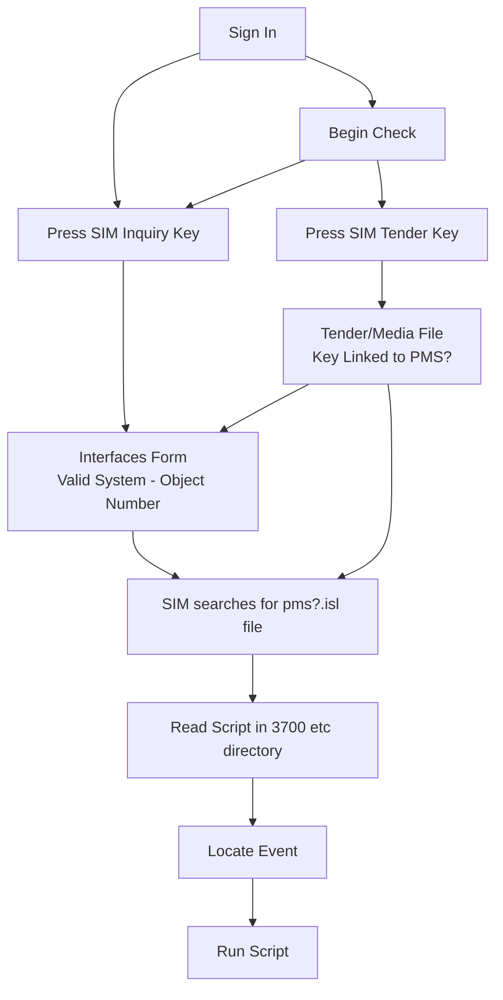

# Chapter 1: Understanding SIM and ISL

This chapter contains an overview of the System Interface Module (SIM) and the Interface Script Language (ISL).

## Getting to Know SIM and ISL

### What is the System Interface Module?

The System Interface Module (SIM) extends the standard functionality of the 3700 Software through the MICROS proprietary Interface Script Language (ISL). SIM and ISL provide the resources to enhance daily operations quickly and easily.

In this section, we introduce SIM and ISL, and explain how this module and script language work together.

SIM is a 3700 software component that allows the POS Operations module to interface to a variety of third-party systems. A special script language known as ISL provides access to SIM.

A property may use SIM to communicate with third-party systems, such as a Property Management System (PMS) or pizza delivery system, by means of a special interface, called a SIM Interface. You must develop a SIM Interface to exchange messages between the 3700 System and the third-party system.

For developing a SIM Interface, ISL handles 2700 Compatibility fixed format and ISL format. Refer to “Message Formats and Interface Methods” on page 2-3 for a discussion of message formats and interface methods.

What is a SIM Interface? A SIM Interface is an ISL script that exchanges messages between a third-party system and SIM.

- The SIM Interface provides more than charge inquiry and posting capabilities. With SIM, all PMS functions are available. In the PMS world, a SIM Interface allows you to:
- Initiate guest checkout
- Provide guest location information
- Print guest messages
- Enter guest history

SIM supports an ISL message format that allows you to send and receive almost any message format. This allows you to create custom interfaces to a PMS or other third- party system.

- Many of the features of a PMS environment are available to other types of systems via a SIM Interface. SIM allows the 3700 to:
- Enter and recall customer information
- Recall orders and provide customer order history
- Enhance traditional PMS functions handled on the POS side

Accessing SIM ISL, a MICROS proprietary interpreted language, facilitates access to SIM. ISL scripts direct SIM to execute a series of instructions called events. SIM events are discussed later in this section.

Enabling SIM The 3700 System must be configured to interpret instructions contained in the script. 3700 database programming links the script and the SIM Interface. Once enabled, SIM carries out the instructions in the script when an employee presses a specially programmed key to initiate an event.

### Characteristics of ISL

ISL is a MICROS proprietary interpreted language that creates small programs called scripts. Scripts contain the SIM instructions.

ISL includes easy-to-learn, easy-to-use language elements: a repertory of commands, functions, and system variables, as well as simple statement formats. These language elements combine to create instructions that execute when the script runs.

ISL resembles BASIC (or variants) in its linear structure. The flow of scripts is in a step-by-step structure but does not require line numbering. Like BASIC and other structured languages, ISL supports decision-making language elements such as If…Else, and loop constructs using the For…EndFor and Forever…EndFor commands.

- Language Elements and Components ISL contains language elements common to most interpreted languages. They include:
- Commands allow the designer to:
- Control the flow of instructions in the script
- Define and manipulate variables
- Communicate with a third-party system
- Read and write data to and from the server or a PCWS
- Send data to print devices
- ISL functions that enhance text handling and formatting.
- System variables that read definition and totals information from the database and set system parameters
- Operators (relational and logical) that perform mathematical actions on variable and constant operands
- Format specifiers used with commands, that specify the format of input and output data

Event Procedures ISL is also event-oriented. An event is a group of statements and commands defined by ISL Event…EndEvent commands. Scripts provide a frame-like structure for sequences of events.

A specially programmed key or a message response received from a third-party system initiates an event. Once an event executes successfully, SIM stops processing the script until another event begins.

- The example that follows performs the following tasks:
- Displays an ISL-defined window on the UWS screen,
- Prompts for a room number
- Sends the room number and the number of the Transaction Employee to a third- party system (e.g., PMS)

```isl
event inq : 1                                     // Execute when SIM Inquiry key 1
                                                         is pressed
    var room_num : N5                             // Declare local variable
    window 2, 19, “Room Inquiry”                  // Create input window
    display 2, 2, “Enter Room Number”             // Issue operator prompt
    input room_num, “ “                           // Accept input
    txmsg room_num, @tremp                        // Transmit room number and Transaction
                                                  //     Employee to third-party system
   waitforrxmsg                                   // Wait for response from third-party
endevent
```

After the third-party system acknowledges receipt of the data, the event ends.

If the employee at the UWS initiates another event, SIM begins processing the script again.

#### Script Writing

What is a Script File? ISL issues instructions to SIM through small programs called scripts. A script is an ASCII text file that you create in any common ASCII text editor. Scripts can contain one or more events to launch SIM applications.

A single script is maintained for each SIM Interface defined for a System. The script is linked to a SIM Interface through 3700 database programming so that the script can be executed by the 3700 System. For specific programming requirements, refer to “Programming the 3700 System for SIM” on page 2-9.

If You are Familiar with Script Writing… Script writing is a common way to issue instructions to a computer, so you may be familiar with this concept. Scripts written for ISL have a specific format and include elements unique to this language. We recommend that you familiarize yourself with the language elements and script structure. Refer to “Guidelines for Creating Scripts” on page 3-6.”

If You are New to Script Writing… This manual contains a brief introduction to this method of automating operations. If you have never used scripts before, we recommend that you review this introductory material to familiarize yourself with script writing. Refer to “Getting Started with Script Writing” on page 3-2.

### How ISL Accesses SIM

You access SIM through instructions executed by a script, written with ISL. Each script may contain several events, each of which performs different tasks.

#### Initiating an Event

SIM executes a script’s instructions, when any of several events occur. Following is a
brief description of the available 3700 SIM events. For detailed information on each
event, please see the Event...EndEvent command in SIM Online Help.

- Event inq - this event is executed when a SIM inquiry key is pressed. This key is
  programmed in the 3700 database.
- Event tmed - this event is executed when a SIM tender key is pressed. This key is
  programmed in the 3700 database.
- Event rxmsg - this event is executed when a response is received from the third-
  party system interfaced to the 3700.
- Event final_tender - this event executes when the last tender event occurs, but
  before a check has closed.
- Event print_header, Event print trailer- these events print additional header or
  trailer information on custom receipts, guest checks, and credit card vouchers.
- Event srvc_total - this event is executed when a check is service totalled.
- Event trans_cncl - this event is executed when a SIM transaction cancel key is
  pressed.
- Event init - this event is executed when POS operations is started. This event should
  be used to perform any initialization required by the script. No user input is allowed
  in this event.
- Event exit - this event executes when POS operations is exiting. No user input is
  allowed in this event.
- Event idle_no_trans - this event is used to run SIM scripts in the background, when
  POS operations is idle and no one is signed in.

#### Pressing a SIM Inquiry or Tender Key

The flowchart on the next page illustrates what happens when an operator at a UWS presses a SIM Inquiry or SIM Tender key.

- First, SIM verifies certain required parameters within the 3700 database
- After verifying that certain programming options and links are set up, SIM searches for the script
- Once SIM finds the correct script, it looks for a valid event, linked to the SIM Inquiry or SIM Tender key, that the operator pressed to initiate the whole process
- Finally, after locating a valid event, SIM runs the script and executes the instructions contained in the event



#### Interfacing with a Third-Party System

Several communications commands and system variables can be issued by events in your script. These commands and system variables can be used to send messages to a third-party system. In turn, the third-party system acknowledges these messages and responds over an interface method (i.e., RS-232 or TCP) using a message format recognized by the 3700 System. Message formats and interface methods supported by SIM are described in “Message Formats and Interface Methods” on page 2-3.

- During this exchange, the SIM Interface acts as the go-between for both systems by shuttling the messages back and forth. A simplified version of the exchange goes like this:
- The 3700 System will transmit a message to a third-party system with a TxMsg command statement in a script.
- The SIM Interface will put the message in a format that is acceptable to the third- party system.
- Then, the third-party system will acknowledge the message and send back a response, such as data requested by SIM.
- The SIM Interface will forward the response to the 3700 System in a message format acceptable to the POS: either fixed format or ISL format.

## Features of SIM

SIM provides a variety of features to help you create functional and useful SIM applications with ISL. The main features of SIM include support for:

- Common communications message formats and interface methods for development of SIM Interfaces. This includes a variety of methods for displaying, capturing, and printing information.
- Initiating a macro in 3700 POS operations.
- Comprehensive file I/O processing operations.

### Methods of Displaying, Capturing, and Printing Data

Processing input and output, as well as printing data are the mainstay of most POS transactions. Consequently, 3700 SIM handles the following input and output operations:

- Capturing input data - you have the use of a PC keyboard, touchscreen, or a magnetic card reader.
- Displaying data - SIM displays data in the 3700 POS operations window.
- Printing data - SIM uses a versatile set of print commands and system variables, also called print directives.

You can design a script to display information in several places on the POS operations window, including ISL-defined windows, and the prompt line.

#### Windows

Probably the most common place to both enter and display data is an ISL-defined window. Windows are drawn to your specifications and appear in front of the transaction detail and summary sections of the POS operations screen.

#### The Prompt Line

To help users step through operations more easily, user prompts can be provided on the prompt line.

#### Graphics Characters

In addition to windows, you also can create other figures, such as a smaller box within a window, with right angles, as well as horizontal and vertical lines.

ISL creates these figures by displaying line draw graphics characters at locations defined by the Display command. You access the Graphics Character Set with the Chr function.

A listing of the Graphics Character Set is provided with the detail description of the Display Command in SIM Online Help.

#### Touchscreens

SIM can make touchscreens pop up if they are defined by the Devices|Touchscreen form in the 3700 database or by ISL Touchscreen Commands.

##### Programmed Touchscreens

Programmed touchscreens are already defined in the Touchscreen form of the 3700 database. A programmed touchscreen that you might pop up in an event, is an alpha or alphanumeric one. For example, if an event prompts an operator to enter the name of a customer, the UWS’s default alpha touchscreen displays so the operator can enter the customer’s name.

##### ISL-Defined Touchscreens

To accommodate those instances where a programmed touchscreen is not appropriate, we provide several commands that let ISL display touchscreens built within the script, or touchscreens created on-the-fly. An ISL-defined touchscreen comes in handy when you need to use function keys for a very specific purpose, and there is not a programmed touchscreen to accommodate your need.

Take the case where the user may be prompted to respond to a Yes-No question: The script instructs SIM to display touchscreen keys [Yes] and [No]. Depending on which key the operator selects, additional instructions are carried out. For example, if the operator chooses [Yes], output from the transaction is sent to a local printer instead of the remote roll printer.

#### Data Entry

The entry of data is accepted from a PC keyboard, a touchscreen, or a magnetic card reader. Normally, scripts that instruct an operator to collect data, such as name and address information, require entry using one of these methods.

##### Touchscreen

During the execution of a script, data entry from a touchscreen is accepted. To support data entry from the touchscreen, ISL includes commands for displaying a programmed or ISL-defined touchscreen when one is required. Normally, the script should display a touchscreen in order for the operator to select data from it. The data could be menu items, in which case, the script should pop up a sales transaction type touchscreen. Or, the script could direct the operator to enter the customer’s name, in which case, an alpha touchscreen should pop up for the operator to use.

##### Magnetic Card Reader

Data that can be stored as track data on a magnetic card is also accessible by SIM. Usually, track data includes a reference number, such as a credit card account number, and an expiration date. For instance, the account number of a country club member could be stored as track data, allowing the operator to capture it from the POS by swiping the member’s card through the magnetic card reader.

#### Printing

Supervised, unsupervised, and backup printing are accomplished by ISL through the use of several ISL commands and a variety of ISL system variables.

##### Print Commands and Print Directives

Print commands start print jobs, while the system variables, also called print directives, change the print characteristics of generated text. The print directives change the print type, similar to how standard parallel printer escape sequences work. For instance, if you want to print some text in red ink, you can do so with a print directive.

##### Supervised Printing and Unsupervised

Supervised printing is supported only for guest check, customer receipt, and validation printers. Unsupervised printing includes remote and local order output, and the journal. Backup printers, other than those already defined in the 3700 database, can be specified in the case of unsupervised printing only.

##### Type of Printers

Supported All output can be generated at roll and slip printers.

### Interfacing with Third-Party Systems

Communications are handled by SIM through a variety of commands that support the exchange of messages between a third-party system and a 3700 System.

The type of messages sent back and forth between these two systems will typically include blocks of data. For instance, the third-party system may be used as a repository for data, such as customer name and address information in a customer database. This data might be used by the 3700 System to verify information in the third-party database with information input from the POS side.

In order for the 3700 System to send and accept data from a third-party system, you must develop and enable a SIM Interface using the interface methods supported by SIM, and also put the messages in a format accepted by SIM.

## Creating SIM Applications with ISL

ISL is your gateway to the System Interface Module (SIM) of the 3700 System Software. When ISL is used correctly, you can harness this powerful script language to build useful and practical SIM applications for all types of POS environments, including restaurants, bars, hotels, country clubs, etc.

### Benefits of SIM Applications

The impact of your SIM applications on these POS environments will be immediate, especially when you use them to make certain POS transactions and functions easier for operators to perform. Such applications have the added benefit of making the System easier and simpler to use, thus, improving overall customer service.

Equally important, is the fact that creating SIM applications also enable you to expand the capabilities of the 3700 System. With these applications, you can take the System beyond its traditional function and improve existing features. For example, you could make guest charge posting faster, improve user prompting and System messaging, and track customers through the collection of information, like names and addresses. Whether simple or complex, when implemented properly, these types of SIM applications can make the System a more powerful tool for users.

### Types of SIM Applications

Although SIM applications can emphasize a variety of features, the applications you're likely to implement might involve such features as:

- Collecting and saving data for future retrieval or tracking, such as tracking customer sales in order to generate coupons, as rewards or incentives for frequent diners
- Expediting certain POS operations, like automatically applying a discount to a guest check when certain conditions are met
- Communicating with a third-party system, such as a Pizza Delivery System
- Printing and posting information to checks in ways that the system may not be programmed to do so, like generating messages with special instructions for kitchen staff

In this section, there are several real-world examples of SIM applications, implementing a combination of SIM features. We’ve provided these examples to give you an idea of the type of SIM applications you can create with ISL. Keep in mind: These are only examples, and implementations of similar SIM applications can vary.

### Generating Coupons for Customers

The collection of data, such as customer information, is easily handled by SIM. Such data can be captured and used by a third-party delivery system, interfaced with the 3700 System, allowing the entry and recall of customer name and address information.

Since you can track customer sales and other data this way, ISL makes it easy for you to develop SIM applications that create rewards for customers. Most common are rewards in the form of coupons and other incentives. Customers redeem these coupons for cash, gifts, reduced purchase price, etc.

Frequent Diners Customers who frequently patronize an establishment are often targeted to receive rewards and incentives for their continued loyalty. At our fictional restaurant, a Birthday Club is one of the incentive programs offered to frequent diners.

Let’s assume that a third-party database exists with pertinent information about frequent diners, such as name, account number, birthdate, etc., for sales tracking purposes. In addition, let’s also assume that the restaurant issues frequent diners a special VIP card, including an account number and birthdate as track data.1 Whenever the frequent diner visits the restaurant, the diner must present their VIP card so the server can credit sales to the frequent diner’s account.

- Generating a Birthday Coupon A server generates a “Birthday Coupon” based on the information that our fictional restaurant is tracking. The coupon is redeemable for a free appetizer upon the customer’s next visit. At this restaurant, the Birthday Club works like this:
- The magnetic card reader reads the birthdate from the VIP card track data 2.
- The system checks it against the current system date. If the birthdate is equal to the system date, then the system will automatically issue a Birthday Coupon when the server closes the guest check.
- When presenting the guest check, the server also gives the diner their “Birthday Coupon”.

1.   This term refers to information stored on the magnetic stripe of a credit card. The information is often stored on separate areas of the magnetic stripe, called tracks. For example, the account number and birthdate in this example are stored on Track 2 of the magnetic stripe.

### Interfacing with a Pizza Delivery System

Applying a Discount to a Check You can expedite certain POS transactions with SIM applications. If you make it possible for operators to complete common, repetitive transactions more quickly and efficiently, a property can improve the turnaround time of operations. A better turnaround time means that operators can spend less time at POS terminals and more time attending to customers’ needs.

With ISL, you can tackle these types of transactions in small ways. Usually, you can do this by taking out the decision-making steps in certain procedures.

Discounts are a good example. Frequently, an establishment will offer an item at a reduced price if a customer spends a certain amount. Deciding whether to apply a discount and which discount to use are left up to the operator, allowing room for errors to occur: the operator forgets to take the discount or applies the wrong discount.

Applying a Discount to a Total Our SIM application removes these two steps from a discount procedure that an operator performs. The application automatically applies a discount if the check total is a certain amount, e.g., $50.00.

Applying a Discount to an Item Another discount example, is applying a discount only to specific menu items. This might be necessary if, for instance, the restaurant doesn’t want to reduce the price of an item and call it a “Special”. But rather, the restaurant wants to discount the item by a certain percentage and track the discount.

The discount works like this: If a customer orders a certain entree, any appetizers on the check are half price. In this instance, a 50% discount is applied to the appetizer items.

One of the important features of ISL is its ability to support an interface between the 3700 System and a third-party system. Such an interface allows both systems to communicate with each other by handling the exchange of messages between the systems.

Let’s examine a fictional pizza delivery system at a pizzeria. Over a SIM Interface, the 3700 System captures customer information input on the POS side, then the information is sent to the third-party delivery system. A SIM Interface enables the operator to retrieve this information from the delivery system’s database, as needed, through a query, or search.

### Collecting Customer Information for a Membership List

Guest Check Information Detail Information that you might capture and store in a third-party database is name and address information, the customer’s telephone number, as well as directions to the customer’s residence. When a customer telephones our fictional pizzeria, an operator uses the customer’s telephone number to access any existing information in the pizza delivery system’s database.

As an added benefit, this SIM application also prints this customer information on the guest check. For instance, the directions to the customer’s residence prints on the check for the delivery person to reference.

Previous Order History In addition to name and address information, a customer’s order history is also information that the third-party system maintains. By retrieving previous order history, the operator eliminates the additional steps required to post order information, namely menu items, to a guest check. If the customer always order’s a large, pepperoni and mushroom pizza, these items can be retrieved from the third-party database, and posted to the check, without directly accessing the menu item keys again. In a fast-paced environment like a pizza delivery operation, where quick turnaround is critical, eliminating steps in the order entry process is a real advantage.

Many implementations of SIM applications collect data, such as name and address information or guest history. Collecting and storing this information enables you to retrieve it for later use.

For example, you can interface with a third-party system, to send data to and retrieve it from another system, as described in the pizza delivery system example on 1-15. This information can be used to generate membership lists to be used for special promotions.

### Customizing Output

Printing is an essential POS function that can be expanded to accommodate the unique preferences of a property. Currently, a 3700 System comes equipped with many different programming options that affect how things are printed, where they print, and when they will print. With ISL, you can further customize printing for a property by extending the functionality of the 3700 System beyond its normal programmable limits.

We’ve already mentioned ISL’s special printing abilities in the previous examples, such as printing customer information on guest checks and generating coupons for customers. Now let’s examine how you can save servers’ time when they must send special instructions to kitchen staff about orders.

Sending Special Messages to the Kitchen Our SIM application allows an operator to pick a message from a list, then send the message to the kitchen. The pick list includes messages frequently sent to the kitchen, which is a feature that current programming options for number lookups (NLUs) do not support.

A remote roll printer in the kitchen generates the following message on a chit:

Creating Raffle Tickets Another good example of how you can use the special printing capabilities of ISL, is creating output other than guest checks, remote order chits, customer receipts, etc.

Earlier in this section, we discussed how you can generate a coupon with ISL. Now, let’s create a raffle ticket for hotel guests.

This application requires that the 3700 System interface with a PMS. The application performs a common PMS task: collecting a guest’s name and room number when the operator closes a guest check in one of the hotel’s food and beverage outlets.

For this application, ISL verifies the input with data already stored in the PMS database. Based on how many times the guest has patronized the hotel’s four star restaurant, for example, a raffle ticket chit is generated after the guest check prints.

The raffle ticket includes an excursion option, which was selected from a pick list of others, as well as the guest’s name and room number. ISL also automatically assigns a ticket number to the chit.
