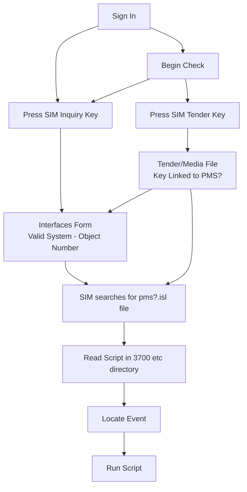

# ISL reference: SIM Guide (RES 3700)

Source: 3700 SIM Guide PDF (2004 edition; predates some events, see events.md for the current list). Plain-text extraction; grep by keyword.

Restaurant Enterprise Series
System Interface Module (SIM) Companion Guide

Copyright 2003
by MICROS Systems, Inc.
Columbia, MD USA
All Rights Reserved

## Preface

3700 SIM documentation is divided into two parts. This guide includes:
- How to enable SIM in the 3700 database
- How to write a SIM script
- Guidelines on how to use SIM language elements

The second part of 3700 SIM documentation is includes the language elements used in SIM applications:
- Commands
- Functions
- System Variables
- Data Types, Specifiers, and Operators
- Key Names and Key Codes
- Error Messages


### Conventions and Symbols

The following conventions are used throughout this manual.

```
Convention                                 Meaning
[Key]                          Keys on a PC or PC Workstation. Example: [Enter]
‘Message’                      Messages that may appear during the programming
                               process. Example: ‘Select Menu Item Range’
Courier                        Information to be entered by a User. Example:
                               copy a:\readme.txt c:\micros
bold                           Boldface is used to indicate files, paths, or directory
                               names. Example: c:\windows\pbrush.exe
[Key1]+[Key2]                  The plus sign (+) between key names indicates that
                               you should press the keys simultaneously.
|                              Indicates the sequence of menu items to be
                               selected. Example: File | Sales | Condiments
```

## Chapter 1: Understanding SIM and ISL

This chapter contains an overview of the System Interface Module (SIM) and the Interface Script Language (ISL).

```
In This Chapter...
       • Getting to Know SIM and ISL . . . . . . . . . . . . . . .              1-2
       • Features of SIM . . . . . . . . . . . . . . . . . . . . . . . . . .    1-9
       • Creating SIM Applications with ISL . . . . . . . . . .                1-13
```

## Getting to Know SIM and ISL

### What is the System Interface Module?

The System Interface Module (SIM) extends the standard functionality of the 3700 Software through the MICROS proprietary Interface Script Language (ISL). SIM and ISL provide the resources to enhance daily operations quickly and easily.

In this section, we introduce SIM and ISL, and explain how this module and script language work together.

SIM is a 3700 software component that allows the POS Operations module to interface to a variety of third-party systems. A special script language known as ISL provides access to SIM.

A property may use SIM to communicate with third-party systems, such as a Property Management System (PMS) or pizza delivery system, by means of a special interface, called a SIM Interface. You must develop a SIM Interface to exchange messages between the 3700 System and the third-party system.

For developing a SIM Interface, ISL handles 2700 Compatibility fixed format and ISL format. Refer to “Message Formats and Interface Methods” on page 2-3 for a discussion of message formats and interface methods.

What is a SIM Interface? A SIM Interface is an ISL script that exchanges messages between a third-party system and SIM.

- The SIM Interface provides more than charge inquiry and posting capabilities. With SIM, all PMS functions are available. In the PMS world, a SIM Interface allows you to:
- Initiate guest checkout
- Provide guest location information
- Print guest messages
- Enter guest history

SIM supports an ISL message format that allows you to send and receive almost any message format. This allows you to create custom interfaces to a PMS or other third- party system.

- Many of the features of a PMS environment are available to other types of systems via a SIM Interface. SIM allows the 3700 to:
- Enter and recall customer information
- Recall orders and provide customer order history
- Enhance traditional PMS functions handled on the POS side

Accessing SIM ISL, a MICROS proprietary interpreted language, facilitates access to SIM. ISL scripts direct SIM to execute a series of instructions called events. SIM events are discussed later in this section.

Enabling SIM The 3700 System must be configured to interpret instructions contained in the script. 3700 database programming links the script and the SIM Interface. Once enabled, SIM carries out the instructions in the script when an employee presses a specially programmed key to initiate an event.

### Characteristics of ISL

ISL is a MICROS proprietary interpreted language that creates small programs called scripts. Scripts contain the SIM instructions.

ISL includes easy-to-learn, easy-to-use language elements: a repertory of commands, functions, and system variables, as well as simple statement formats. These language elements combine to create instructions that execute when the script runs.

ISL resembles BASIC (or variants) in its linear structure. The flow of scripts is in a step-by-step structure but does not require line numbering. Like BASIC and other structured languages, ISL supports decision-making language elements such as If…Else, and loop constructs using the For…EndFor and Forever…EndFor commands.

- Language Elements and Components ISL contains language elements common to most interpreted languages. They include:
- Commands allow the designer to:
- Control the flow of instructions in the script
- Define and manipulate variables
- Communicate with a third-party system
- Read and write data to and from the server or a PCWS
- Send data to print devices
- ISL functions that enhance text handling and formatting.
- System variables that read definition and totals information from the database and set system parameters
- Operators (relational and logical) that perform mathematical actions on variable and constant operands
- Format specifiers used with commands, that specify the format of input and output data

Event Procedures ISL is also event-oriented. An event is a group of statements and commands defined by ISL Event…EndEvent commands. Scripts provide a frame-like structure for sequences of events.

A specially programmed key or a message response received from a third-party system initiates an event. Once an event executes successfully, SIM stops processing the script until another event begins.

- The example that follows performs the following tasks:
- Displays an ISL-defined window on the UWS screen,
- Prompts for a room number
- Sends the room number and the number of the Transaction Employee to a third- party system (e.g., PMS)

```
event inq : 1                                     // Execute when SIM Inquiry key 1
                                                         is pressed
    var room_num : N5                             // Declare local variable
    window 2, 19, “Room Inquiry”                  // Create input window
    display 2, 2, “Enter Room Number”             // Issue operator prompt
    input room_num, “ “                           // Accept input
    txmsg room_num, @tremp                        // Transmit room number and Transaction
                                                  //     Employee to third-party system
   waitforrxmsg                                   // Wait for response from third-party
endevent
```

After the third-party system acknowledges receipt of the data, the event ends.

If the employee at the UWS initiates another event, SIM begins processing the script again.

#### Script Writing

What is a Script File? ISL issues instructions to SIM through small programs called scripts. A script is an ASCII text file that you create in any common ASCII text editor. Scripts can contain one or more events to launch SIM applications.

A single script is maintained for each SIM Interface defined for a System. The script is linked to a SIM Interface through 3700 database programming so that the script can be executed by the 3700 System. For specific programming requirements, refer to “Programming the 3700 System for SIM” on page 2-9.

If You are Familiar with Script Writing… Script writing is a common way to issue instructions to a computer, so you may be familiar with this concept. Scripts written for ISL have a specific format and include elements unique to this language. We recommend that you familiarize yourself with the language elements and script structure. Refer to “Guidelines for Creating Scripts” on page 3-6.”

If You are New to Script Writing… This manual contains a brief introduction to this method of automating operations. If you have never used scripts before, we recommend that you review this introductory material to familiarize yourself with script writing. Refer to “Getting Started with Script Writing” on page 3-2.

### How ISL Accesses SIM

You access SIM through instructions executed by a script, written with ISL. Each script may contain several events, each of which performs different tasks.


#### Initiating an Event

SIM executes a script’s instructions, when any of several events occur. Following is a
brief description of the available 3700 SIM events. For detailed information on each
event, please see the Event...EndEvent command in SIM Online Help.

- Event inq - this event is executed when a SIM inquiry key is pressed. This key is
  programmed in the 3700 database.
- Event tmed - this event is executed when a SIM tender key is pressed. This key is
  programmed in the 3700 database.
- Event rxmsg - this event is executed when a response is received from the third-
  party system interfaced to the 3700.
- Event final_tender - this event executes when the last tender event occurs, but
  before a check has closed.
- Event print_header, Event print trailer- these events print additional header or
  trailer information on custom receipts, guest checks, and credit card vouchers.
- Event srvc_total - this event is executed when a check is service totalled.
- Event trans_cncl - this event is executed when a SIM transaction cancel key is
  pressed.
- Event init - this event is executed when POS operations is started. This event should
  be used to perform any initialization required by the script. No user input is allowed
  in this event.
- Event exit - this event executes when POS operations is exiting. No user input is
  allowed in this event.
- Event idle_no_trans - this event is used to run SIM scripts in the background, when
  POS operations is idle and no one is signed in.

#### Pressing a SIM Inquiry or Tender Key

The flowchart on the next page illustrates what happens when an operator at a UWS presses a SIM Inquiry or SIM Tender key.

- First, SIM verifies certain required parameters within the 3700 database
- After verifying that certain programming options and links are set up, SIM searches for the script
- Once SIM finds the correct script, it looks for a valid event, linked to the SIM Inquiry or SIM Tender key, that the operator pressed to initiate the whole process
- Finally, after locating a valid event, SIM runs the script and executes the instructions contained in the event



#### Interfacing with a Third-Party System

Several communications commands and system variables can be issued by events in your script. These commands and system variables can be used to send messages to a third-party system. In turn, the third-party system acknowledges these messages and responds over an interface method (i.e., RS-232 or TCP) using a message format recognized by the 3700 System. Message formats and interface methods supported by SIM are described in “Message Formats and Interface Methods” on page 2-3.

- During this exchange, the SIM Interface acts as the go-between for both systems by shuttling the messages back and forth. A simplified version of the exchange goes like this:
- The 3700 System will transmit a message to a third-party system with a TxMsg command statement in a script.
- The SIM Interface will put the message in a format that is acceptable to the third- party system.
- Then, the third-party system will acknowledge the message and send back a response, such as data requested by SIM.
- The SIM Interface will forward the response to the 3700 System in a message format acceptable to the POS: either fixed format or ISL format.

## Features of SIM

SIM provides a variety of features to help you create functional and useful SIM applications with ISL. The main features of SIM include support for:

- Common communications message formats and interface methods for development of SIM Interfaces. This includes a variety of methods for displaying, capturing, and printing information.
- Initiating a macro in 3700 POS operations.
- Comprehensive file I/O processing operations.

### Methods of Displaying, Capturing, and Printing Data

Processing input and output, as well as printing data are the mainstay of most POS transactions. Consequently, 3700 SIM handles the following input and output operations:

- Capturing input data - you have the use of a PC keyboard, touchscreen, or a magnetic card reader.
- Displaying data - SIM displays data in the 3700 POS operations window.
- Printing data - SIM uses a versatile set of print commands and system variables, also called print directives.

You can design a script to display information in several places on the POS operations window, including ISL-defined windows, and the prompt line.

#### Windows

Probably the most common place to both enter and display data is an ISL-defined window. Windows are drawn to your specifications and appear in front of the transaction detail and summary sections of the POS operations screen.

#### The Prompt Line
To help users step through operations more easily, user prompts can be provided on the prompt line.

#### Graphics Characters
In addition to windows, you also can create other figures, such as a smaller box within a window, with right angles, as well as horizontal and vertical lines.

ISL creates these figures by displaying line draw graphics characters at locations defined by the Display command. You access the Graphics Character Set with the Chr function.

A listing of the Graphics Character Set is provided with the detail description of the Display Command in SIM Online Help.

#### Touchscreens
SIM can make touchscreens pop up if they are defined by the Devices|Touchscreen form in the 3700 database or by ISL Touchscreen Commands.

##### Programmed Touchscreens
Programmed touchscreens are already defined in the Touchscreen form of the 3700 database. A programmed touchscreen that you might pop up in an event, is an alpha or alphanumeric one. For example, if an event prompts an operator to enter the name of a customer, the UWS’s default alpha touchscreen displays so the operator can enter the customer’s name.

##### ISL-Defined Touchscreens
To accommodate those instances where a programmed touchscreen is not appropriate, we provide several commands that let ISL display touchscreens built within the script, or touchscreens created on-the-fly. An ISL-defined touchscreen comes in handy when you need to use function keys for a very specific purpose, and there is not a programmed touchscreen to accommodate your need.

Take the case where the user may be prompted to respond to a Yes-No question: The script instructs SIM to display touchscreen keys [Yes] and [No]. Depending on which key the operator selects, additional instructions are carried out. For example, if the operator chooses [Yes], output from the transaction is sent to a local printer instead of the remote roll printer.

#### Data Entry
The entry of data is accepted from a PC keyboard, a touchscreen, or a magnetic card reader. Normally, scripts that instruct an operator to collect data, such as name and address information, require entry using one of these methods.

##### Touchscreen
During the execution of a script, data entry from a touchscreen is accepted. To support data entry from the touchscreen, ISL includes commands for displaying a programmed or ISL-defined touchscreen when one is required. Normally, the script should display a touchscreen in order for the operator to select data from it. The data could be menu items, in which case, the script should pop up a sales transaction type touchscreen. Or, the script could direct the operator to enter the customer’s name, in which case, an alpha touchscreen should pop up for the operator to use.

##### Magnetic Card Reader
Data that can be stored as track data on a magnetic card is also accessible by SIM. Usually, track data includes a reference number, such as a credit card account number, and an expiration date. For instance, the account number of a country club member could be stored as track data, allowing the operator to capture it from the POS by swiping the member’s card through the magnetic card reader.

#### Printing
Supervised, unsupervised, and backup printing are accomplished by ISL through the use of several ISL commands and a variety of ISL system variables.

##### Print Commands and Print Directives
Print commands start print jobs, while the system variables, also called print directives, change the print characteristics of generated text. The print directives change the print type, similar to how standard parallel printer escape sequences work. For instance, if you want to print some text in red ink, you can do so with a print directive.

##### Supervised Printing and Unsupervised
Supervised printing is supported only for guest check, customer receipt, and validation printers. Unsupervised printing includes remote and local order output, and the journal. Backup printers, other than those already defined in the 3700 database, can be specified in the case of unsupervised printing only.

##### Type of Printers
Supported All output can be generated at roll and slip printers.


### Interfacing with Third-Party Systems

Communications are handled by SIM through a variety of commands that support the exchange of messages between a third-party system and a 3700 System.

The type of messages sent back and forth between these two systems will typically include blocks of data. For instance, the third-party system may be used as a repository for data, such as customer name and address information in a customer database. This data might be used by the 3700 System to verify information in the third-party database with information input from the POS side.

In order for the 3700 System to send and accept data from a third-party system, you must develop and enable a SIM Interface using the interface methods supported by SIM, and also put the messages in a format accepted by SIM.


## Creating SIM Applications with ISL

ISL is your gateway to the System Interface Module (SIM) of the 3700 System Software. When ISL is used correctly, you can harness this powerful script language to build useful and practical SIM applications for all types of POS environments, including restaurants, bars, hotels, country clubs, etc.

### Benefits of SIM Applications
The impact of your SIM applications on these POS environments will be immediate, especially when you use them to make certain POS transactions and functions easier for operators to perform. Such applications have the added benefit of making the System easier and simpler to use, thus, improving overall customer service.

Equally important, is the fact that creating SIM applications also enable you to expand the capabilities of the 3700 System. With these applications, you can take the System beyond its traditional function and improve existing features. For example, you could make guest charge posting faster, improve user prompting and System messaging, and track customers through the collection of information, like names and addresses. Whether simple or complex, when implemented properly, these types of SIM applications can make the System a more powerful tool for users.

### Types of SIM Applications
Although SIM applications can emphasize a variety of features, the applications you're likely to implement might involve such features as:

- Collecting and saving data for future retrieval or tracking, such as tracking customer sales in order to generate coupons, as rewards or incentives for frequent diners
- Expediting certain POS operations, like automatically applying a discount to a guest check when certain conditions are met
- Communicating with a third-party system, such as a Pizza Delivery System
- Printing and posting information to checks in ways that the system may not be programmed to do so, like generating messages with special instructions for kitchen staff

In this section, there are several real-world examples of SIM applications, implementing a combination of SIM features. We’ve provided these examples to give you an idea of the type of SIM applications you can create with ISL. Keep in mind: These are only examples, and implementations of similar SIM applications can vary.

### Generating Coupons for Customers

The collection of data, such as customer information, is easily handled by SIM. Such data can be captured and used by a third-party delivery system, interfaced with the 3700 System, allowing the entry and recall of customer name and address information.

Since you can track customer sales and other data this way, ISL makes it easy for you to develop SIM applications that create rewards for customers. Most common are rewards in the form of coupons and other incentives. Customers redeem these coupons for cash, gifts, reduced purchase price, etc.

Frequent Diners Customers who frequently patronize an establishment are often targeted to receive rewards and incentives for their continued loyalty. At our fictional restaurant, a Birthday Club is one of the incentive programs offered to frequent diners.

Let’s assume that a third-party database exists with pertinent information about frequent diners, such as name, account number, birthdate, etc., for sales tracking purposes. In addition, let’s also assume that the restaurant issues frequent diners a special VIP card, including an account number and birthdate as track data.1 Whenever the frequent diner visits the restaurant, the diner must present their VIP card so the server can credit sales to the frequent diner’s account.

- Generating a Birthday Coupon A server generates a “Birthday Coupon” based on the information that our fictional restaurant is tracking. The coupon is redeemable for a free appetizer upon the customer’s next visit. At this restaurant, the Birthday Club works like this:
- The magnetic card reader reads the birthdate from the VIP card track data 2.
- The system checks it against the current system date. If the birthdate is equal to the system date, then the system will automatically issue a Birthday Coupon when the server closes the guest check.
- When presenting the guest check, the server also gives the diner their “Birthday Coupon”.

1.   This term refers to information stored on the magnetic stripe of a credit card. The information is often stored on separate areas of the magnetic stripe, called tracks. For example, the account number and birthdate in this example are stored on Track 2 of the magnetic stripe.

### Interfacing with a Pizza Delivery System

Applying a Discount to a Check You can expedite certain POS transactions with SIM applications. If you make it possible for operators to complete common, repetitive transactions more quickly and efficiently, a property can improve the turnaround time of operations. A better turnaround time means that operators can spend less time at POS terminals and more time attending to customers’ needs.

With ISL, you can tackle these types of transactions in small ways. Usually, you can do this by taking out the decision-making steps in certain procedures.

Discounts are a good example. Frequently, an establishment will offer an item at a reduced price if a customer spends a certain amount. Deciding whether to apply a discount and which discount to use are left up to the operator, allowing room for errors to occur: the operator forgets to take the discount or applies the wrong discount.

Applying a Discount to a Total Our SIM application removes these two steps from a discount procedure that an operator performs. The application automatically applies a discount if the check total is a certain amount, e.g., $50.00.

Applying a Discount to an Item Another discount example, is applying a discount only to specific menu items. This might be necessary if, for instance, the restaurant doesn’t want to reduce the price of an item and call it a “Special”. But rather, the restaurant wants to discount the item by a certain percentage and track the discount.

The discount works like this: If a customer orders a certain entree, any appetizers on the check are half price. In this instance, a 50% discount is applied to the appetizer items.

One of the important features of ISL is its ability to support an interface between the 3700 System and a third-party system. Such an interface allows both systems to communicate with each other by handling the exchange of messages between the systems.

Let’s examine a fictional pizza delivery system at a pizzeria. Over a SIM Interface, the 3700 System captures customer information input on the POS side, then the information is sent to the third-party delivery system. A SIM Interface enables the operator to retrieve this information from the delivery system’s database, as needed, through a query, or search.

### Collecting Customer Information for a Membership List

Guest Check Information Detail Information that you might capture and store in a third-party database is name and address information, the customer’s telephone number, as well as directions to the customer’s residence. When a customer telephones our fictional pizzeria, an operator uses the customer’s telephone number to access any existing information in the pizza delivery system’s database.

As an added benefit, this SIM application also prints this customer information on the guest check. For instance, the directions to the customer’s residence prints on the check for the delivery person to reference.

Previous Order History In addition to name and address information, a customer’s order history is also information that the third-party system maintains. By retrieving previous order history, the operator eliminates the additional steps required to post order information, namely menu items, to a guest check. If the customer always order’s a large, pepperoni and mushroom pizza, these items can be retrieved from the third-party database, and posted to the check, without directly accessing the menu item keys again. In a fast-paced environment like a pizza delivery operation, where quick turnaround is critical, eliminating steps in the order entry process is a real advantage.

Many implementations of SIM applications collect data, such as name and address information or guest history. Collecting and storing this information enables you to retrieve it for later use.

For example, you can interface with a third-party system, to send data to and retrieve it from another system, as described in the pizza delivery system example on 1-15. This information can be used to generate membership lists to be used for special promotions.

### Customizing Output

Printing is an essential POS function that can be expanded to accommodate the unique preferences of a property. Currently, a 3700 System comes equipped with many different programming options that affect how things are printed, where they print, and when they will print. With ISL, you can further customize printing for a property by extending the functionality of the 3700 System beyond its normal programmable limits.

We’ve already mentioned ISL’s special printing abilities in the previous examples, such as printing customer information on guest checks and generating coupons for customers. Now let’s examine how you can save servers’ time when they must send special instructions to kitchen staff about orders.

Sending Special Messages to the Kitchen Our SIM application allows an operator to pick a message from a list, then send the message to the kitchen. The pick list includes messages frequently sent to the kitchen, which is a feature that current programming options for number lookups (NLUs) do not support.

A remote roll printer in the kitchen generates the following message on a chit:

Creating Raffle Tickets Another good example of how you can use the special printing capabilities of ISL, is creating output other than guest checks, remote order chits, customer receipts, etc.

Earlier in this section, we discussed how you can generate a coupon with ISL. Now, let’s create a raffle ticket for hotel guests.

This application requires that the 3700 System interface with a PMS. The application performs a common PMS task: collecting a guest’s name and room number when the operator closes a guest check in one of the hotel’s food and beverage outlets.

For this application, ISL verifies the input with data already stored in the PMS database. Based on how many times the guest has patronized the hotel’s four star restaurant, for example, a raffle ticket chit is generated after the guest check prints.

The raffle ticket includes an excursion option, which was selected from a pick list of others, as well as the guest’s name and room number. ISL also automatically assigns a ticket number to the chit.

## Chapter 2: Getting Started

This chapter contains a description of the message formats and interface methods that must be used to develop a SIM Interface. Also included, is a description of the 3700 database programming required to enable SIM and a SIM Interface.

```
In This Chapter...
        • Getting Started with ISL and SIM. . . . . . . . . . . . .   2-2
        • Message Formats and Interface Methods . . . . . . .         2-3
        • Programming the 3700 System for SIM . . . . . . .           2-3
```

## Getting Started with ISL and SIM

```
Getting Started with ISL and SIM
          Understanding exactly what purpose the System Interface Module (SIM) and the
          Interface Script Language (ISL) serve, as well as how they interact, are the first steps
          you should take toward learning how to create SIM applications. Chapter One
          answers these questions about SIM and ISL.
```

- This chapter focuses on the steps that must be taken in order for you to implement your SIM applications successfully. In this chapter, you’ll learn:
- What communications message formats and interface methods are available for developing a SIM Interface
- How to enable SIM and a SIM Interface

Developing Your SIM Interface If you intend to create SIM applications that require communicating with a third-party system, such as a PMS or delivery system, you must develop a SIM Interface. This interface must utilize supported message formats and interface methods to facilitate communications between the 3700 System and the third-party system. In “Message Formats and Interface Methods” on page 2-3, we discuss the message formats and interface methods to apply when creating your SIM Interface.

Enabling SIM and a SIM Interface There is specific 3700 database programming you must define to enable SIM and a SIM Interface, and execute a script successfully. In this chapter, we summarize these requirements in “Programming the 3700 System for SIM” on page 2-9.

## Message Formats and Interface Methods
To develop your SIM Interface, use the message formats and the interface methods described in this section.

### Message Formats

There are two classes of message format: 2700 Compatibility fixed format and ISL format.

```
Note         To ease the migration to the new SIM Interface capabilities, you can
             use both formats over the same type of interface.
```

2700/4700 Compatibility Fixed Message Format Support for this message format allows a PMS compatible with 2700-style messages to communicate with a 3700 System via a SIM Interface.

The fixed message format should be used in cases where the third-party system requires 2700-style compatibility due to pre-existing PMS installations.

Message Format The format of the message is as follows:

#### SOH ID STX Data ETX Checksum EOT

The 1000/2000/4700/8700 PMS Interface Specifications Manual describes how to design this interface and defines each segment of the message. Please refer to this manual for more information.

ISL Message Format Messages defined using ISL are structured like fixed messages, except that the Data segment of a fixed message is broken out into two segments in the ISL message: Application_Sequence and Application_Data. The segments of the ISL message are enveloped using control characters. IBM PC character codes, an ASCII superset, provide support for international characters.

The format of the ISL message is as follows:

```
SOH ID STX FS Application_Sequence Application_Data ETX Checksum EOT
```

A description of each message segment follows.

`SOH` The SOH character (start of header) serves as a message lead-in character that identifies the start of a new message. The SOH character is represented by the 7-bit hexadecimal value 01H, plus a parity bit, if applicable.

`ID` This is the POS Source ID segment that includes information about the UWS. The UWS initiates the message and identifies the interface.

#### The format of this segment is as follows

```
Field            Length              Format                         Remarks
POS UWS Number            9 Bytes       2 or 9 ASCII Digits       May contain leading spaces or
                                                                  zeroes and is between 1 and
                                                                  9999999, depending on 2/9 digit
                                                                  ID in PMS Definition File.
                                                                  Standard PMS format is 2 digits.
Interface Name            16 Bytes      16 ASCII Characters       May not contain intervening
                                                                  spaces
```

`STX` The STX character (start of text) serves as a data field lead-in character that identifies the start of the message data block. The STX character is represented by the 7-bit hexadecimal value 02H, plus a parity bit, if applicable.

`FS` The FS character (field separator) identifies this message as a SIM message data block. The FS character is represented by the 7-bit hexadecimal value 1CH, plus a parity bit, if applicable.

Application_Sequence The Application_Sequence segment comprises a two-digit sequence number and a retransmission flag. Each POS UWS application increments its own sequence number with each message. When a message is being retransmitted, the same sequence number will be used as the original message. In addition, a retransmit flag character is provided.

```
Field             Length          Format                        Remarks
Applications              2 Bytes       2 ASCII Digits     May contain zeroes and is between 01
Sequence Number                                            and 99
Retransmission Flag       1 Byte        Space or ‘R’       ‘R’ character (ASCII 52H) is placed in
Character                                                  this field if this is a retransmitted
                                                           message.
```

The `Application_Sequence` number is initially set to “01” when the application starts. The application rolls the sequence number back to “01” after “99”.

If the third-party system receives a message containing the same sequence number as the previous message and the retransmit flag is set, the third-party should retransmit the last response.

`Application_Data` Both the TxMsg and RxMsg commands define the Application_Data segment. Multiple fields can comprise this segment. Individual fields within the Application_Data segment are separated by the ASCII field separator character (1CH), inserted by ISL.

In addition, the first field within the receive message Application_Data segment defines the name of the ISL procedure to execute when processing the response message. The detail description of the RxMsg command describes the relationship between the command and the Application_Data segment of an ISL message.

`ETX` The ETX character (end of text) serves as a data field lead-out character that identifies the end of the message data block. The ETX character is represented by the 7-bit hexadecimal value 03H, plus a parity bit, if applicable.

`Checksum` The Checksum field is only used when communicating over an asynchronous serial interface. A TCP-based SIM Interface will ignore this field. When the Checksum is part of the message, however, format it as follows:

```
Field           Length          Format                           Remarks
Checksum          4 Bytes       4 ASCII Hex       Contains ASCII characters in the range 30H -
                                characters        39H and 41H - 46H (0-9 and A-F).
```

The Checksum is the 16-bit binary addition (excluding parity, if applicable) of all characters after the SOH, up to and including the ETX character. The Checksum is initially set to zero. For transmission, the Checksum is represented as four ASCII-Hex characters.

EOT The End of Transmission character (EOT) identifies the end of the message. It is represented by the hexadecimal value 04H, plus a parity bit, if applicable.

The total size of the message can be 32K from the SOH to the EOT.

```
Note          While the asynchronous serial interface messages are not limited, it
              is recommended that they be no more than 1024 bytes in length so
              that the interface remains responsive.
```

### Interface Methods

SIM supports two types of interface: an asynchronous serial interface and a TCP-based interface. Both interface methods support the 3700-compatible fixed-format message and the ISL message format.

```
Note         Both the fixed and ISL formats may be used over the same interface.
```

#### Asynchronous Serial Interface
This type of interface method supports communications with a third-party system over an Asynchronous Communications Adapter (COM port) installed in the PC that controls the 3700 system. This interface is widely used to implement a PMS Interface to facilitate communications between a 3700 system and a PMS. With the introduction of SIM, this interface method can also be your choice for implementing a SIM interface.

Asynchronous Serial Interface Specifications
Specifications for developing an asynchronous serial interface are defined in the 1700/2000/4700/8700 PMS Interface Specifications Manual. Refer to this manual for more information about this type of interface method.

#### TCP Interface
This interface is designed to connect the 3700 System to systems using the TCP/IP networking protocol. You can also use this interface to facilitate communications between the POS application and third-party applications that reside on the same platform as the 3700 System Software. This interface is also compatible with many forms of local area networks (LANs), including Ethernet, Token Ring, FDDI, Arcnet, PPP, etc.

##### TCP Connection
SIM connects to the TCP port as a client. The SIM Server should accept TCP connections from the 3700 POS client on the port “micros-sim”. If this service is not defined, the port number 5009 should be used as the default. This information is programmed in the Interfaces form in the 3700 database.

##### Error-Handling
If the receiving system detects an error in the message or some other applications- related error, it should provide an appropriate error message response to the POS application. In addition, if you are using the fixed message format, response messages should handle error messages. As such, to support these conditions, ISL should define specific error responses.

##### Pinging
The TCP connection has a typical “keep-alive time-out of two hours. In order to detect a “down” interface more quickly and re-establish the connection, SIM periodically sends a “ping” message to the server. The server should detect the ping message and return the message in it’s original format.

The format of the ping message should be as follows:

`SOH ID STX ETX EOT`

The ID source segment contains a null address: the POS UWS number will be zero and the interface name will contain spaces.

## Programming the 3700 System for SIM
After you create a SIM Interface, you must program the 3700 database. This section includes a quick reference programming chart to help experienced programmers get started quickly. Also included, are more in-depth descriptions of the programming action steps.

### Prerequisites

In order to effectively implement the programming action steps described in this section, you should have an understanding of the following:
- 3700 database structure
- POS database programming concepts
- POS Configurator

For more information on programming a 3700 System database and usage of the POS Configurator module, refer to the 3700 POS Configurator User’s Guide.

### Database Programming Quick Reference

For quick reference, the table below outlines the action steps that you must complete in order to program the database. Each of these action steps is discussed briefly on pages -11 through -12.

```
                          Database Files/Program
Action Steps                                                         Procedure
                                 Affected
1   Define Interface    Devices|Interfaces                  Define interfaces.
2   Create SIM         Devices|Touchscreen Designer         Create new inquiry key.
    Inquiry Key
3   Create SIM         Devices|Touchscreen Designer         Create new tender key or use an
    Tender Key         Sales|Tender/Media                   existing tender key, in the
                                                            Sales|Tender Media form.
```

Enable appropriate options. Select an interface from the PMS tab.

```
4   Write a Script     None                                 Write your SIM script using the
                                                            information provided in “Guidelines
                                                            for Creating Scripts” on page 3-6.
5   Name and Store     None                                 Assign the filename pms###.isl to
    Script                                                  script file, where ### is the object
                                                            number assigned to the PMS.
```

Store pms###.isl in \3700\etc

### Database Programming Action Steps

This section discusses these action steps in a summary fashion. For a complete description of individual programming elements, refer to the 3700 Feature Reference Manua

#### Step 1: Define the Interface

`Devices|Interfaces`

#### Step 2: Create SIM Inquiry Key

`Devices|Touchscreen Designer`
- Create a SIM Inquiry key to initiate a corresponding event in a script. Pressing a SIM Inquiry key is one of several ways to initiate an ISL event.
- Link the key to the event with a function key code that tells SIM where to look for the event and which event to execute

#### Step 3: Create SIM Tender Key

`Sales|Tender/Media Form`
`Devices|Touchscreen Designer`

- Create a SIM Tender key to initiate a corresponding ISL tender event in a script.
- Link the key to a SIM Interface by choosing the interface from the drop down menu in the `Sales|Tender/Media|PMS` tab.
- Like SIM Inquiry keys, SIM Tender keys must be linked to a corresponding event procedure.
- Link the tender event to the SIM Tender key by using the object number assigned to it in the Sales|Tender/Media Form. For example, if the Cash key is defined as object number 10 in the Tender/Media File, then use this object number in the Event Tmed command syntax (i.e., Event Tmed : 10).
- In the case of a SIM Tender key, the tender/media event is the only valid event initiated by this key.

```
Note         The tender event must be executed while in a transaction, i.e., while a
             guest check is open.
```

#### Step 4: Write a SIM Script

Write your SIM script using the information provided in “Guidelines for Creating Scripts” on page 3-6.

#### Step 5: Name and Store Scripts
- Name the script pms###.isl, where “###” is the Interface object number in the 3700 Interfaces form. For example, the file for Interface object number 4 must be called pms4.isl. There should be no leading zeros in the numeric portion of the filename.
- Store the script in the \3700\etc directory. In the instance when pms###.isl or script.isl cannot be found, SIM will issue an error.


## Getting Started with Script Writing
This section introduces you to the process of script writing.

If you are familiar with this process, this section provides the specific conventions and formats you need to know in order to write scripts with the ISL. And if you are new to script writing, this section includes the information you need to begin using scripts for the first time.

Specifically, this chapter covers:
- What a script is
- Why you use scripts
- What the parts of a script are
- How to write a script
- What is proper script writing style
- How to test a script
- How to document your script for others
- How to encrypt your scripts

## What is a Script?
The means by which the ISL issues instructions to the SIM is through small programs known as scripts. A script is an ASCII text file that you create in any common ASCII text editor, such as Edit, the Notepad Windows editor. These scripts can contain one or more events to implement SIM applications.

### Structure of a Script

A separate script must be maintained for each SIM Interface defined for a System. The script is linked to a SIM Interface through 3700 database programming. Once you form this relationship through database programming, the script can be executed by the SIM. For specific programming requirements, refer to “Programming the 3700 System for SIM” on page 2-9.

The basic structure of your scripts should be written in a format similar to the sample script below. When writing your script, keep the following structure in mind. A brief description of each part follows the diagram.

Comments
Comments are used to document the purpose and scope of events included in the script. Place comments anywhere in the script, but make sure each comment line is preceded by two backslash characters “//” (see page 3-9).

Global Variable Declarations
Global variables are initialized at the beginning of each script and maintained for the duration of the script.

Event Declaration
ISL is event-oriented. Almost all ISL statements will be contained in events or subroutines called by those events (see Event...EndEvent Command in the SIM Online Help.

There are several types of events:
- Event inq - this event is executed when a SIM inquiry key is presssed. This key must be programmed in the 3700 database.
- Event tmed - this event is executed when a SIM tender key is pressed. This key must be programmed in the 3700 database.
- Event rxmsg - this event is executed when a response is received from the third- party system interfaced to the 3700 System.
- Event final_tender - this event is executed whenever the last tender event has occurred, but before a check has closed.
- Event print_header - this event will print additional header or trailer information on custom receipts, guest checks, and credit card vouchers.
- Event print trailer - this event will print additional trailer information on custom receipts, guest checks, and credit card vouchers.
- Event srvc_total - this event is executed when a check is service totalled.
- Event trans_cncl - this event is executed when a SIM transaction cancel key is pressed.
- Event init - this event is executed when POS operations is started. This event should be used to perform any initialization required by the script. No user input is allowed in this event.
- Event exit - this event executes when POS operations is exiting. No user input is allowed in this event.
- Event idle_no_trans - this event is used to run SIM scripts in the background, when POS operations is idle and no one is signed in. If an employee should sign in, this event won’t be called until the employee signs out again. The frequency at which the SIM script is called is determined by the @Idle_Seconds system variable.

Local Variable Declaration Commands
Local variables are purged after each event completes execution; the event terminates after an EndEvent, ExitCancel, ExitContinue, or any other command that causes the event to stop executing, successfully or not.

Subroutine Declaration
Subroutine procedures are called from other event or subroutine procedures, allowing common code to be used by multiple events. As a script writing convention, we recommend that you place all subroutines after all events in the script. See Sub..Endsub Command in the SIM Online Help.

## Creating Scripts
Scripts consist of one or more events. Each event within the script represents a task that you want the SIM to perform. For instance, in Chapter One we discuss several different types of SIM applications. Each of these applications can exist as separate events within the same script.

### Guidelines for Creating Scripts

When you begin to develop your SIM applications, use the guidelines below to create the script.

- Understand the tasks that you want your script to perform.
- Outline the structure of the script. In plain English, write down the steps you
       want to automate in each event. Carefully note each detail about the tasks that
       the event will accomplish.
- Write a brief description of the task each event or subroutine performs. For
       future reference, this description should appear as a comment before each
       event and subroutine in the script.
- Note any input and output. Does the user enter data? Do you need to generate
       a guest check, remote order chit, etc.?
- Think about what assumptions your making about the environment. For
       instance, if the application applies a discount to a check total greater than or
       equal to $50.00, you should test for this case in the script before applying the
       discount.
- Protect yourself against the user. The event should not allow users to get stuck
            or to perform a task that they should not. For example, if you request input
            from an operator and the operator gives you incorrect input, then you should
            issue an error to force the operator to enter the requested information.
- Determine what variables (global, local) you need to declare. For a discussion of
  user variables, refer to “User Variables” on page 4-10.
- Determine whether some of the events in the script perform similar tasks. If they
  do, you should consider creating a subroutine to save time in writing the script and
  to make the script process instructions more efficiently.

### Examples of Scripts

- Translate the instructions you write into one or more lines of code.
- Consult the ISL Quick Reference in the SIM Online Help to determine what commands, functions, and system variables allow you to perform the desired task.
- Learn what considerations are involved in writing ISL statements. “Script Writing Style” on page 3-9 covers these guidelines.
- Review the detail descriptions of the required language elements. The examples provided with detail descriptions can be helpful as templates from which you can build your own ISL statements.

#### Charge Posting

This script posts a charge to a PMS system and waits for the response.

```isl
var guest_id:a20

event tmed : 1                                 //PMS room charge key is
  // Tender key #1
  input guest_id, "Guest posting, enter name or room #"
  txmsg "CHG_POSTING", guest_id, @TNDTTL, @CHKNUM,@RVC
  waitforrxmsg
endevent

event rxmsg : chg_posting
  var status : a1
  var message : a20,
  var temp_tndttl : $12

  rxmsg status, message

  if status="P"                                          //Posting approved
    saverefinfo message


    exitcontinue
  endif


  if status = "E"                                         //Error
    exitwitherror message
  endif
endevent
```

#### Charge Denial

This script places a window with the title “Charge Denied” on the screen, and provides text in it with the reason why the charge was denied. The operator is then prompted to press the [Clear] key before cancelling the operation.

```isl
event rxmsg : denial_msg
  var reason_text : a32
  rxmsg reason_text
  window 3, 34, "Charge Denied"
  display 2,@CENTER, reason_text
  waitforclear
  exitcancel
endevent
```

#### Address and Phone Number Entry
This example prompts the operator to enter a customer’s address and phone number.

```isl
var phone_num : N7                                 //Global variable, keep phone
// number around.
event inq : 1                                      //Use Inquiry key #1 to get guest info.
  var cust_name : A32
  var addr1 : A32
  var addr2 : A32
  var addr3 : A32
  var special_instructions : A32

  window 7, 50, "Customer Info"
  display 2,2, "Phone Number:"
  displayinput 2, 18, phone_num{:###-####}, "Enter phone number"
  display 3,2, "Customer name:"
  displayinput 3,18,cust_name, "Enter customer's name"
  display 4,2, "Address Line 1:"
  displayinput 4,18,addr1, "Enter address"
  display 5,2, "Address Line 2:"
  displayinput 5,18,addr2, "Enter address"
  display 6,2, "Address Line 3:"
  displayinput 6,18,addr3, "Enter address"
  display 7,2, "Instructions:"
  displayinput 7,18,special_instructions, "Enter instructions"
  windowinput

  // send information to a third party system
  txmsg phone_num, cust_name, addr1, addr2, addr3, special_instructions

  waitforrxmsg
endevent
```

## Script Writing Style
Before you begin writing your first script, review the style conventions in this section.
            For readability, you should apply these conventions in your script writing.
### Case

ISL statements are case-insensitive and the use of case in examples is purely for clarity and the author’s choice of style. However, quoted strings are case-sensitive.

### Length of Variables

The maximum character length for all variable names (user variables, subroutines, etc.) is 255.

```
Comments (//)
```

Declarations and commands will always be on their own line and should be the first non-white space characters. A comment may be placed on a line by beginning the comment with “//” characters. All characters to the right of the comment identifier “// ” are ignored. For example:

```isl
Window 2,19, "ROOM INQUIRY"//Create window //Prompt for room number
```

```isl
Display 2,2,          "Enter Room Number"
```

A comment may reside on its own line or to the right of a command and its arguments. Lines should be terminated with an ASCII carriage return, or an ASCII linefeed, or a carriage return/line feed pair.

### Continuation Lines (\)

```
Continuation Lines (\)
```

A line continuation character “\” is provided to allow commands to continue from one line to the next. For example, a command that overflows several lines might be: TxMsg field1, field2, field3, field4, \ field5, field6, field7, field8, field9

It is not possible to break apart a string with a line continuation character:

```
Correct:
    errormessage “Choose a number between 1 ”,\
                 “and 10”
Incorrect:
    errormessage “Choose a number between 1\
                 and 10”
```

Line continuation characters may not be followed by comments or any other commands.

### Whitespace

Whitespace in ISL is defined as spaces or tab characters inserted into a program to either separate commands from their arguments or to improve program readability. For example, the programmer might find it easier to write: numrow = ( ( ( num_guest - 1 ) * 2 ) + header )

instead of: numrow=(((num_guest-1)*2)+header)

Whitespace can be placed anywhere in a script between two distinct language elements. Language elements are: commands, functions, system variables, user- defined variables, input/output specifiers, comments (//), relational and boolean operators, and commas. A language element is an indivisible piece of information which, if broken apart with whitespace, will generate an ISL token error. For a complete listing of error messages, please see SIM Online Help.

For example, the number -125.99 cannot be written as -125. 9 9. The command WaitForClear cannot be written as Wait For Clear.

The table below shows examples of the incorrect use of whitespace. This incorrect usage will produce error messages.

```
                             Incorrect Use of                Correct Use of
ISL Language
                               Whitespace                     Whitespace
Within a variable name     num        _   columns = 1       num_columns = 1
Within a numeric value     - 19 8.         45                -198.45
Within a command           A     12                         A12
format specifier           N     5                          N5
                           $     12                         $12
Within a comment           /      / comment...              // comment...
delimiter
Within double-character    a <   > b                        a<>b
relational operators       count <          = 5             count     <=   5
Between the @ and a        @     TNDTTL                     @TNDTTL
System Variable name       @     YEAR                       @YEAR
```

The following table shows examples of where whitespace increases program readability:

```
No Whitespace                              With Whitespace
var count[10]:N5                            var count[ 10 ] : N5
display 1,2,"Room is ",room                display 1, 2, "Room is ", room
txmsg "CHG",guest,@tndttl+1.00             txmsg "CHG", guest, @tndttl + 1.00
```

## Writing and Editing Scripts

### Storing the Script

```
Writing and Editing Scripts
            Your scripts should be composed in an ASCII text file and saved with a the filename
            pmsxxx.isl.
Note          There is no need to compile the script or to process it in any other
              way before the SIM can read it.
```

In order for SIM to access the script, you must make sure the script has been assigned the filename pms###.isl and stored in the \micros\res\pos\etc directory. The # must match the interface object number in the 3700 database.

### If You Edit the Script…

Also keep in mind that if you edit the script, you must save it as an ASCII text file.

### Avoiding Errors

- To avoid errors when writing and editing scripts, follow these basic guidelines:
- Make sure the script has been assigned the filename pms###.isl and stored in the \micros\res\pos\etc directory.
- Check your 3700 database programming.
- Review the structure of the script.

- Are all global variables declared at the beginning of the script?

- Within each event, have you declared all local variables before issuing the first command?

- Are the subroutines that you call in events also within the same script? Does the called subroutine have the same name as the actual subroutine?

- Look at your programming style. See “Script Writing Style” on page 3-9.

- Check that events correspond to the correct SIM Inquiry or SIM Tender keys initiating the event or tender event, respectively. For further details about creating these keys, refer to “Programming the 3700 System for SIM” on page 2-9

- Check the script for syntax errors. For instance, make sure that if a command has a corresponding command ending the task, include it. For example, the Event command must be used with the EndEvent command, which should always be the last line of an event procedure.

## Testing Scripts

### Detecting Errors in Logic

```
Testing Scripts
             Before you use the SIM application in a live environment, we recommend that you
             test it for errors.
```

When you run the script, any errors in syntax are detected by the SIM, and an ISL error message is displayed. However, some errors in logic may not be caught by running the script.

Scripts make no assumptions, and execute your instructions exactly as you have specified them. So it is possible for you to run a script and detect no syntax errors, but still have problems with the logic. This is why we recommend that you step through each task in your script.

### Stepping Through the Script

- Follow these steps to test your script:
- Print the script for reference.
- Mark through each step of the script as you test and correct it. This procedure helps you to track the steps that you test.
- Execute each event in the script. Remember, there are several events: SIM Inquiry key, SIM Tender key, Final Tender, Message response, Header/Trailer.

- Make sure that the SIM Inquiry or SIM Tender key you press executes the correct event. The key should be linked to a corresponding event in the script.

- Test whether communications are active between the two systems and that each system responds appropriately to messages sent to it by the other.

- Make sure you have entered your header/trailer information in the Sales|Descriptors form.
- Test each step of the event, such as the flow and logic of If…EndIf and For loop statements.

- Check any assumptions you make in the script. For instance, if a condition must exist in order for the next step to occur, check the condition. You might need to display an error message or perform another step until this condition is met.

- Check the logic of each task. For example, if the script collects data from the user before querying a third-party database, you should make sure that the script prompts the user for data entry before starting the query.

- Correct any detected syntax errors. The ISL error message will provide the number of the line in the script where the error is found.

- Verify inputs and outputs. For example, if the script calls for a coupon to be generated when an operator closes a guest check, test for this case.

- Insure that the script handles all error conditions and presents a meaningful error to the user.

## Encrypting Scripts

### Encryption Program Files

```
Encrypting Scripts
             Once you’ve created a script, you can use the ISL Encryption Program to code the
             script so that it is unreadable by anyone. This program converts the script into an
             encoded decimal format. Once encrypted, the script cannot be converted back to a
             readable format.
```

You’ll find instructions in this section that describe how to install the Encryption Program and how to use the Encryption Program in both interactive or command line modes.

The following files are related to the encryption process:

```
File                                    Description
ISLCRYPT.EXE           The executable program that encrypts an ISL script
ISLCRYPT.DOC           A README.DOC file containing summary information on
                       using the encryption program
```

### Installing ISLCRYPT.EXE

- Complete the following steps to install the encryption program.
- Create a new directory called isl. For example:

c:\>md isl

- Copy ISLCRYPT.EXE from the distribution diskette to c:\isl. For example:

c:\>copy a:\islcrypt.exe c:\isl

### Command Syntax

[path]islcrypt [[path]/input_file] [path]/output_file \ [ “user_description” ] ]

```
Parameter                                    Description
islcrypt                   The utility file name
input_file                 The ISL script file name you wish to encrypt
output_file                The encrypted ISL script file name
“user_description”         the user-defined text embedded in the file for
                           identification
Guidelines
    o Both the program and script may be located in any directory. See the following
      example:
              File                                       Location
islcrypt.exe                       c:\isl
script file                        c:\3700\etc\pms1.isl
```

- The output_file and user_description are optional. The output_file name is required when using the user_description.
- The user_description must be enclosed in quotes (for example, “PMS Interface Script”). The number of characters is limited to the DOS Command Line maximum. If no user_description is given, “Micros Encrypted ISL Script File” will be embedded in the file.
- It is recommended that the output_file always be specified. If the output_file is not specified, the input_file will become the encrypted file. It is also recommended to enter a user_description, since once the file is encrypted, the file cannot be read by standard editing programs and the user_description will be the only way of identifying the script.
- In order to access both the encryption program and the script, you must specify the full directory path name. If the full path name is not given, an error message will occur. All errors are listed in “Error Messages” on page 3-20

### Using the Encryption Program

The Utility is run from the DOS command line or through interactive system prompts.

```
Before You Begin
     Prior to using the Encryption Program, perform the following precautionary steps:
     o Make a backup of the original script. Note the name of the original file, and of its
       backup.
Warning!         Once the script has been encrypted, there is no way to reverse the
                 procedure.
```

- Verify that the backup script exists.
- Change to the directory holding the file to be encrypted.

```
Encrypting a Script in Command Line Mode
     This procedure allows you to encrypt a script by entering the command syntax at a
     DOS prompt.
     To encrypt a script in command line mode complete the following steps:
     1. Take the precautionary steps in "Before You Begin."
     2. Enter the command syntax at the prompt. For example:
         c:\isl\islcrypt script.isl script.xsl “PMS Interface
         Script”
Encrypting a Script in Interactive Mode
     An alternative to command line mode is encrypting a script using the interactive
     mode. In this mode, the user is prompted to enter the command syntax by the
     Encryption Program.
     To encrypt a script in interactive mode complete the following steps:
     1. Take the precautionary steps in “Before You Begin” on page 3-19.
     2. Change to the directory where ISLCRYPT.EXE is stored. For example:
         c:\>cd isl
```

### Error Messages

3. Enter islcrypt at the prompt. The encryption program will prompt ‘Input filename?’

4. Enter the full directory path of the input_file. The Encryption Program will prompt ‘Output filename?’

5. Enter the full directory path of the output_file. The Encryption Program will prompt ‘File description?’

6. Enter a unique description of the output_file within quotes.

```
Viewing an Encrypted Script
    To view the description of an encrypted script complete the following steps:
    1. Change to the directory where the encrypted script is stored.
    2. Enter type pms1.isl at the prompt. The encrypted script will be displayed in
       the following format: ‘!!!PMS Interface Script’.
```

The following are possible error messages associated with the encryption process:

```
Message                       Description                           Action
islcrypt: not found        This error message indicates        Check the directory path. Then
                           that the Encryption Program         re-enter the command syntax
                           cannot be found because the         with the correct full directory
                           full directory path was not         path.
                           specified, or incorrectly
                           specified, in the command
                           syntax.
Error: Cannot Access       This error message indicates        Check the directory path and
file ‘[path]/input_file’   that the input_file does not        the source directory for the
                           exist, or the full directory path   input_file. Then, re-enter the
                           for the input_file was not          command syntax with the
                           specified, or incorrectly           correct full directory path.
                           specified, in the command
                           syntax.
```

## Merging Scripts

```
Merging Scripts
          We provide a utility that allows you to merge unencrypted scripts with encrypted
          scripts. The purpose of the ISL Merge Program is to allow you to distribute an
          unencrypted configuration file with an encrypeted script.
```

Configuration files, also scripts, provide the script designer with flexibility when distributing the same encrypted script to multiple sites. For example, some variable information in the script may vary from site to site, such as the name of a restaurant, address, or telephone number.

To make these changes, a user can change the unencrypted configuration file, then merge the configuration file with an encrypted script. The end result forms a complete encrypted output file, which is unique to the specifie site.

Example The script below prints out a custom coupon using the ISL. A chain of restaurants has several sites where the coupons will be distributed. Each site must have its unique name, address, and telephone number printed on each coupon.

```isl
event inq : 1
  //start the print job
  startprint @rcpt
    //print the site into
    printline "-----------------------------"
    printline site_name
    printline site_addr1
    printline site_addr2
    printline site_phone
    printline "-----------------------------"
    call print_coupon
  endprint
endevent
```

Since the same script is distributed to each site, it is not possible to embed the site information into the main script. Consequently, a separate script is created for each site that contais the site configuration parameters.

### Merge Program Files

```isl
//Set these variables to the site name, address,
//and phone number
var site_name : a40 = "My Restaurant"
var site_addr1 : a40 = "12345 Main Street"
var site_addr2 : a40 = "Baltimore, MD 21229"
var site_phone : a40 = "301-210-6000"
```

Using the ISL Merge Program, we can merge this configuration file with the main script.

The following files are related to the merge process:

```
File                                   Description
ISLMERGE.EXE            The executable program that encrypts an ISL script
ISLMERGE.DOC            A README.DOC file containing summary information on
                        using the encryption program
```

Installing ISLMERGE.EXE

- Complete the following steps to install the merge program.
- Create a new directory called islmerge. For example: c:\>md islmerge
- Copy ISLMERGE.EXE from the distribution diskette to c:\islmerge. For example: c:\>copy a:\islmerge.exe c:\islmerge

### Command Syntax

[path]islcrypt [[path]/input_file] [path]/output_file \ [ “user_description” ] ]

```
Parameter                                   Description
unencrypted_source             The utility file name
encrypted_source               The unencrypted ISL script file name you wish to
                               merge; also called the configuration file
new_encrypted_source           The encrypted output file
```

- Guidelines
- Both the program and script may be located in any directory. See the following example:

```
File                                     Location
islmerge.exe                      c:\islmerge
script file                       c:\3700\etc\pms1.isl
```

- The output_file and user_description are optional. The output_file name is required when using the user_description.
- Both the unencrypted_source and encrypted_source must be valid ISL scripts.
- The size of the new_encrypted_source may not exceed 64K.
- In order to access both the merge program and the source scripts, you must specify the full directory path name.

### Using the Merge Program

The Utility is run from the DOS command line.

- Before You Begin Prior to using the merge program, perform the following precautionary steps:
- Verify the file names and paths of the files to be merged.
- Change to the directory holding the islmerge program.

```
Merging a Script in Command Line Mode
    This procedure allows you to merge two scripts by entering the command syntax at a
    DOS prompt.
    To merge two scripts in command line mode complete the following steps:
    1. Take the precautionary steps in "Before You Begin."
    1. Enter the command syntax at the prompt. For example:
           c:\isl\islmerge script.isl script.xsl “PMS Interface
           Script
```

## Chapter 4: Using Variables

This chapter contains a description of the data types and operators supported by the ISL, and an introduction to user variables.

```
In This Chapter...
        • Variables and ISL . . . . . . . . . . . . . . . . . . . . . . . . .       4-2
        • Data Types . . . . . . . . . . . . . . . . . . . . . . . . . . . . . .    4-3
        • Relational and Logical Operators . . . . . . . . . . . . .                4-5
        • User Variables . . . . . . . . . . . . . . . . . . . . . . . . . . .     4-10
```

## Variables and ISL

```
Variables and ISL
              As in other programming languages, the ISL supports the use of variables for holding
              information, such as integers or character strings, that may change from from one ISL
              event to another.
```

Typically, variable results are stored in expressions like the following example:

```isl
variable_name = expression
```

An expression is a combination of variables and operators. Expressions may also include constants and functions.

For example, in the expression below, the size of a window is computed from the number of elements in a list:

```isl
window_length = ListSize + 2
```

The user variable window_length has a unique name defined by you, the user. The expression on the right contains a user variable called ListSize, which is added to the integer 2. The result of the expression on the right will be the value assigned to the user variable window_length: the ListSize plus 2.

In this chapter, we describe how to use the language elements that allow you to hold variable information and evaluate expressions of variables.

- This chapter contains the following:
- A listing of the different kinds of data types supported by ISL
- A discussion of the mathematical operators you can use to evaluate expressions containing variables
- A discussion of the type of user variables supported by the ISL

## Data Types

```
Data Types
            The ISL supports several kinds of data types, including numeric, decimal,
            alphanumeric, and key data types, to specify different kinds of variables and
            constants.
```

When a variable is declared using the Var1 command, its data type and size must also be declared. The type and size are referred to as the variable_specifier and type_specifier, respectively.

The table below lists the different kinds of data types and provides the abbreviations you must use when declaring them.

```
Data Type       Abbreviation                   Description                        Example
Numeric                 Nx         These variables are used for numeric       var rowcnt : n3
                                   information and may comprise x digits
                                   (integers, not decimal), e.g., N4
                                   supports -9999 to 9999.
Decimal                 $x         These variables are used for decimal       var new_ttl :
                                   amounts. Operator entries will             $12
                                   assume a decimal place according to
                                   the currency's default setting, as
                                   specified in the System|Restaurant
                                   form for the base currency and the
                                   Sales|Currency form for foreign
                                   currencies; i.e., entering 1234 in the
                                   US will result in an amount of 12.34.
                                   They may comprise x digits, e.g., $4
                                   in the US will support -99.99 to 99.99.
Alphanumeric            Ax         These variables may include any non-       var name : a20
                                   control character, including
                                   punctuation marks. They may
                                   comprise x characters.
1.   For complete description of the Var command, refer to the SIM Online Help.
Data Type    Abbreviation                Description                      Example
Key                key        This system variable is used for key   var keypressed
                              press variables.                       : key
```

Example The examples below declare a 32-character alphanumeric variable and a four-digit room number variable, respectively.

```isl
event : 1

var message_text : A32
var room_num : N4 . . .
```

## Relational and Logical Operators

### Unary Operators

```
Relational and Logical Operators
          The mathematical operators described in this section are supported by the ISL. Before
          using these operators in a script, review each description carefully, as well as the
          “Operator Rules” on page 4-8.
```

For an explanation of the operand types (Nx, $x, Ax, and Key), please see “Data Types” on page 4-3.

#### There are two unary operators

```
Operator         Description                           Example
         Negation operator (a    -3
         minus sign). This is
-        used to negate an       -count
         expression.
                                 -( (     count + 5     )   *   -index       )
          Will negate the         The NOT operator will negate the result of the
          result of the           expression. For example, the following
          expression. The         expression is always TRUE:
          NOT operator can
          be applied to           ( 3 < 4 )
NOT       expressions in the
          same way as the         The NOT operator will negate the sense of the
          unary minus             above expression; thus the following
          operator.               expression is always FALSE:
```

NOT ( 3 < 4 )

Given that ISL expressions are true if they evaluate to a non-zero value, and false if they are zero, the NOT operator will change non-zero values to 0 and 0 values to non- zero. The expression NOT 3 is valid and will evaluate to a 0.

The NOT operator is generally used in If, ElseIf, and While statements to control program flow.

The following example is a subroutine of a loop that executes until the variable done becomes true. sub get_id( ref id ) var done : N3

```isl
done = 0
while NOT done
input id, "Enter id"
if id > 0 AND id < MAX_ID
done = 1
else
errormessage "Not Valid"
endif
endwhile
endsub
```

### Binary Operators

The following table lists the available binary and logical operators in order of precedence (highest to lowest); AND and OR, the logical operators, have a lower precedence than all the binary operators;

```
                                             Allowable Operand
Operation             Operator
                                            Types: Nx, $x, and Ax
multiplication                    *                         Nx, $x
division                           /                        Nx, $x
modulus                           %                         Nx, $x
plus                              +                         Nx, $x
minus                              -                        Nx, $x
bit-wise and                      &                           Nx
bit-wise or                        |                          Nx
equality                          =                     Nx, $x Ax, Key
greater than or equal             >=                    Nx, $x, Ax, Key
greater than                      >                     Nx, $x, Ax, Key
less than or equal                <=                    Nx, $x, Ax, Key
inequality                        <>                    Nx, $x, Ax, Key
less than                         <                     Nx, $x, Ax, Key
logical and                      AND                          Nx
logical or                       OR                           Nx
```

### Operator Rules

Relational Operators All relational operators produce a non-zero value if they are true, and 0 if they are false. For example:

```isl
result = 1 < 2//true, result will be non-zero

result = 100 < 4//false, result will zero
```

Logical (Boolean) Operators The logical (Boolean) AND and OR operators treat their operand as either true (non- zero) or false (zero) values. For example: Fix These

```isl
result = 5 AND 6 //true, since 5 and 6 are both non- zero

result = 5 AND 0//false, since 0 is false

result = 0 OR 0//false, since neither one is true

result = 0 OR 5//true, at least one value is non-zero
```

- Precedence
- ISL expression operands are evaluated from left to right until the end of the expression is reached. For example, note the following expression:

1 + 5 + 2

- This evaluates to 8.
- When expressions mix operators (i.e., + and *), then ISL will use the precedence table to determine which subexpression within the expression will evaluate first. In the following example, the * operator has higher precedence than the + operator, therefore, the last two operands will be combined first, even though they are not the first in the expression:

1 + 5 * 2

- The result is 11 (1 + 10), rather than 12 (6 * 2). The precedence rules are used for all operators. Note the following example:

a < 1 OR b > 3 Since the < operator has greater precedence than the OR operator, a < 1 and b > 3 are evaluated first, and both results are combined with the OR operator.

- Overriding and Clarifying Precedence You can use parentheses to override the default precedence rules. Parentheses are used for two reasons:
- To override the default expression evaluation
- To clarify the expression

Subexpressions enclosed in parentheses always override the operator evaluation. For example, note the following expression:

(1 + 5) * 2

The 1 + 5 is evaluated first since it is within parentheses, even though the multiplier * has higher precedence.

#### The following expression

a < 1 OR b < 3

can be rewritten as:

(a < 1) OR (b < 3)

It is good practice to always place parentheses around subexpressions, to reduce programming errors and to make scripts easier to understand and maintain.

#### For example, the following expression

offset + width * 2 <= w_width / stlen + 1

is equivalent to:

```
(offset + (width * 2) )                <= ( ( w_width / stlen)                 + 1)
```

The second expression is clearer.

## User Variables

### Declaring User Variables

```
User Variables
             User variables are defined by you, the interface designer, and may be used to get
             operator input, such as customer name and address information, a room number, etc.
             They can also reference an entry in a message received over a SIM Interface.
```

Use the Var command to declare user variables. These variables are given a value by an operator, or by the interface, in a response message. Example:

```isl
event inq : 5
var rowcnt : n3 . . .
```

- Guidelines
- The variable name must begin with a letter A-Z, a-z, or the underline character (_).
- The first character cannot be a number. It may subsequently include any character in the range A-Z, a-z, 0-9, or the underscore _ character.
- String variables will initially equal a null string " ".
- Numeric variables will initially equal a 0.

### Local and Global Variables

Variables can be declared either globally or locally.

Global Variables If a variable is declared outside of an Event procedure, it is considered global. The variable is called global because it can be referenced by any event or subroutine in the script. As a result, the ISL must maintain the contents of the variable the duration of a script. The variable is then reset at the start of a new transaction (i.e., when tendering a check). Also, since the variable will be used by other events and subroutines in the script, you only need to declare a global variable once, at the top of the script, before any events or subroutines. Please refer to the Retain/Discard Global Variable command in SIM Online help.

Local Variables Conversely, a variable is considered local when it is declared inside an event procedure. Local variables are only maintained while the event procedure is being executed; executing the EndEvent command, or any other command that stops the script, purges the local variable from the event procedure. Thus, you must declare local variables within event procedures.

Local Variables Used by Subroutines Local variables declared by a parent event procedure are visible within a child subroutine. This functionality is possible because a local variable is accessible to the event in which it is included, and to any child subroutine called by the parent event. Moreover, the contents of a local variable, declared in the parent event, can be changed by the operation of a subroutine called by the same parent event. Consequently, the new contents of the local variable are retained when the subroutine is complete.

### Array Variables

Arrays of variables can also be declared by including an array size with the declaration. The syntax for an array variable is:

#### Var variable_name[array_size]:variable_specifier

The example below declares an array of strings named message_text, containing eight elements, each 32 characters in length.

```isl
var message_text[8]:A32
```

```
Note          The use of brackets in the example above does not denote an optional
              entry, but is actually part of the system.
```

For more information on the Var command, please see the SIM Online Help.

### Variable Size Variables

It is possible to declare a variable with a size that is defined by an expression, rather than a hard-coded number. If the SIM encounters an open parenthesis immediately following the type of the variable, it will assume that an expression follows, defining the variable’s size. For example, the following commands have the same effect:

```isl
var window_width : N30

var window_width : N(15 + 15)
```

This feature is useful for declaring variables whose size is not known until run-time. Example:

```isl
var : a(str_len)
```

### Using List Arrays and Records

The application data message contains the information that the SIM sends to and receives from a PMS. The message consists of a set of ASCII fields, separated by the ASCII field separator (1CH).

In many cases, the number of variables to be sent by the SIM or the PMS is not known until run-time. For example, a script may query the PMS for a list of guests whose last name starts with “SMITH”. The PMS may respond with two names, or with ten names, depending on who is in the hotel at the time.

In order to send and receive variable amounts of data, ISL uses two methods: list arrays and records.

List Arrays The SIM provides more than one method for sending and receiving variable amounts of data within one message. The simplest method is to send a list. A list consists of a list_size and the array_variable that contains the list. The list_size is any user-defined integer variable. The array_variable is any user-defined array, as shown on page -12.

Specifying a List Array A list is specified for an RxMsg or TxMsg command by using empty array brackets ( [] ) after the array name.

Example: Rxmsg list_size, list[]

- When specifying a list array, follow these guidelines:
- The variables used for the list size and the list are user-defined.
- The list size variable should always precede the list array variable.
- Array system variables (e.g., @DTL_OBJNUM) cannot be used as list arrays.
- The values in the list[ ] should be formatted into as many lines as are specified in list_size. In the example below, list_size is 5, thus five values from the list[ ] will be formatted if these ISL statements are executed.

```isl
var list_size : N5
var list[ 10 ] : A20
txmsg list_size, list[]
```

- Using the same example, if we let the [fs] symbol stand for the field separator and the message from PMS is: 5[fs]L1[fs]L2[fs]L3[fs]L4[fs]L5 then:

```isl
listsize = 5
list[ 1 ] = "L1"
list[ 2 ] = "L2"
list[ 3 ] = "L3"
list[ 4 ] = "L4"
list[ 5 ] = "L5"
```

- The PMS should read the first value in the message and receive that many elements from the rest of the message. The RxMsg command reads the data from the message in a similar manner. For example:

```isl
var listsize : N5
var list[ 10 ] : A20

rxmsg listsize, list[]
```

If message from PMS is: 2[fs]L1[fs]L2,then:

```isl
listsize = 2
list[1] = "L1"
list[2] = "L2"
```

If message from PMS is: 4[fs]L1[fs]L2[fs]L3[fs]L4, then:

```isl
listsize = 4
list[1] = "L1"
list[2] = "L2"
list[3] = "L3"
list[4] = "L4"
```

In another example, the script collects a guest name from the operator, transmits the guest name to the PMS, receives a list of names from the PMS, and displays the list in a window:

```isl
event inq : 1
var name : A20
input name, "Enter guest name"
txmsg "GST_INQ", guest
waitforrxmsg
endevent

event rxmsg : GST_RSP
var guest_count : N5   //declare list size var guest_name[10] : A20   //declare list //receive up to 10 names rxmsg guest_count, guest_name[]

//open up window window guest_count, 25, "Guest List" listdisplay 1, 1, guest_name //display names waitforclear endevent
```

- Lists can be intermingled with other non-list variables, as well as other lists. In the following example, one single variable and two lists, each with its size variable, are received from the PMS:

```isl
rxmsg status, guest_count, guest_name[],\ action_count, action_list[]
```

For each list, only one array may be assigned. It is possible, for example, for the PMS to send not only the guest name, but also the room number. One way to handle this would be to receive two lists within one message:

```isl
event rxmsg : GST_RSP
  var guest_count : N5
  var guest_name[10] : A20
  var guest_room[10] : N5
  rxmsg guest_count, guest_name[], guest_count,\
  guest_room[]
  .
  .
endevent
```

Implicit List_Sizes There are occasions where the script writer may desire to use lists, but does not want to actually specify the list_size, since the list_size is not specified in the data. For example, assume that a PMS message contains 20 fields. In order for the ISL to read the message, a separate variable must be specified in the Rxmsg command for each field.

```isl
var n[20] : n5

rxmsg n[1], n[2], n[3], n[4], n[5], n[6], n[7],\ n[8],\n[9], n[10], n[11], n[12], n[13], n[14], n[15],\ n[16], n[17], n[18], n[19], n[20]
```

The ISL provides a method for specifying list_sizes implicitly for those cases when the data does not contain a list_size. An implicit list_size is identified by a pound symbol (#) placed before the list_size. Alternatively, the example above could be written as:

```isl
var n[20]
rxmsg #20, n[]
```

Only integer expressions may be placed in the implicit list_size field. Integer variables may also be used.

```isl
var size : n2 = 20
var n[size] : n5
rxmsg #size, n[]
```

Implicit list_sizes may be used anywhere standard list_sizes may be used.

### Promotion

Records ISL also provides a more powerful, yet more complicated, syntax for specifying variable amounts of data called records. In this format, the variables following the list size are considered to be in groups of records. The syntax for receiving this type of information is:

listsize, list1[] : list2[] : list3[] ...

The colon separates fields within a record and must be used when specifying records.

For example, if the PMS received an inquire on SMITH, then it may want to group the data as follows:

3[fs]Smith[fs]1423[fs]Smithers[fs]1827[fs]Smithson[fs] 1887

Note that each record consists of a name followed by a room number.

To receive the message above, use the following statement:

```isl
rxmsg count, name[] : room[]
```

In this case, the variables would be set as follows: count = 3 name[1] = "Smith" name[2] = "Smithers" name[3] = "Smithson" room[1] = 1423 room[2] = 1827 room[3] = 1887

The same format would be used for transmitting data.

A list specification is a special case of a record format, where each record consists of one element.

ISL allows the programmer to freely combine and assign variables of the different types. For example, it is possible to add a string and an integer, and assign it to a decimal value.

```isl
var amt : $10 amt = 12 + "25" + 100.45
```

Whenever two variables and/or constants are operated upon with an operator, and they are not the same types, one will be “promoted” (have its type changed) before the operation takes place.

Strings promote to integers and integers promote to decimal values. A final promotion occurs when the expression is assigned to a variable. Therefore, the expression is promoted (or demoted) to the variable type.

#### For example, if the following variables are declared

```isl
var string : A20
var integer : N10
var decimal : $10
```

Then the following statements are assigned within an Event procedure, the statements would be equivalent to:

```
Assignment                                  Equivalent To
string = "12" + 35                string = "47"
string = "14.15" + 2              string = "16"
string = "14.15" + 2.00           string = "16.15"
integer = "14" + 12.5             integer = 26
integer = "14.5" + 12.5           integer = 27
                                  expression was real, and then demoted to
                                  integer
decimal = 12.23 + 1               decimal = 13.23
decimal = "12.23" + 1             decimal = 13.00
                                  "12.23" + 1 yields an integer 13, which is
                                  then assigned to decimal
```

Strings are converted to integers by using the first digits in the string field. “12.35” converts to an integer 12, since “.” does not belong in an integer. “12NUM” also converts to 12. Therefore, it is legal to write:

```isl
integer = "ABC123"// integer = 0
```

Only relational operators are allowed between strings; see “Relational and Logical Operators” on page 4-5.

#### Correct

```isl
integer = "12" > "35"
```

#### Incorrect

```isl
integer = "12" + "35
```

## Getting Started with ISL Printing

```
Getting Started with ISL Printing
           Printing in ISL is accomplished using the StartPrint, PrintLine, and EndPrint
           directives (or their variants). The following printing options are supported:
           o Printing can be supervised or unsupervised
           o Backup printers may be specified
           o Printouts can end with Form Feeds or not
           o Printing text in double-wide characters and red ink is also supported
```

This chapter focuses on how to start print jobs and direct your print jobs to System printers. And in performing these tasks, the other options available to you are covered as well, including detecting the status of print jobs, redirecting print jobs to ISL- defined backup printers, and defining a reference line for print error messages.

ISL Print Commands and System Variables All of the commands and system variables associated with ISL printing are discussed. Complete descriptions, including syntax and examples, of all commands discussed in this section are provided in the SIM Online Help. For more information about system variables and their use, refer to Chapter 6, “System Variables”.

## Starting an ISL Print Job

### ISL StartPrint Commands

```
Starting an ISL Print Job
               Both supervised and unsupervised printing supported by the ISL are consistent in
               behavior with the 3700 System. Supervised print jobs include guest checks, customer
               receipts, and validation chits, while both local backup and remote order printing, as
               well as journal printing are considered unsupervised print jobs.
```

- These types of print jobs are initiated by variations of the StartPrint command described in this section. These variations are designed to accommodate:
- The type of print job (supervised or unsupervised) and
- The ability to detect whether a print job completed successfully by using the @PRINTSTATUS system variable.

Printing in ISL is started using one of the commands in the table below. The StartPrint and StartPrintWithStatus commands are used to print to a standard MICROS printer. These printers will print a maximum of 32 characters per line, and understand special formatting.

```
                                                              Sets        Form   Backup    Reference
Command                   Supervised     Unsupervised      @Printstatus   Feed   Printer   Line
StartPrint…                              ®                 ®a             ®      ®         ®
StartPrintWithStatus…     ®                                ®b             ®                ®
a.Always set to “Y”.
b.Set to either “Y”, for Yes (Complete), or “N” for “No” (Failed).
```

Supervised and Unsupervised Printing The StartPrint[WithStatus command should be used for supervised print jobs only, such as guest checks and customer receipts. When this command is used, the system will wait until the print job is completed before continuing with the script. Then, the completion status of the print job will be stored in the system variable @PRINTSTATUS. If the print job fails, the script can be designed to check @PRINTSTATUS and reroute the print job to another printer.

On the other hand, the StartPrint command is defined for unsupervised print jobs only, like journal printing. After executing the StartPrint command, for example, the system would immediately return to processing the script, and let the print job execute in the background. The system variable @PRINTSTATUS always returns successful results for these commands.

Form Feeds To force continuous paper to the beginning of a new line, the StartPrint commands can be issued with a Form Feed (FF) command. To turn off the Form Feed feature, a No Form Feed (NOFF) command is provided.

Backup Printing and Reference Lines The commands used for unsupervised print jobs also allow for the specification of a backup printer in case the print job fails. This backup printer overrides any backup printer already programmed in the database for the specified printer.

In addition, you can also specify text, called a reference line, to appear in printer error messages returned when both supervised and unsupervised print jobs fail.

### Specifying an ISL Printer

When specifying a StartPrint command, you have two options for defining a printer: an object number or a system variable.

Using Object Numbers All printing requires that a printer be specified by the StartPrint[WithStatus] commands. A printer can be identified either by its device table entry number (Object Number), a system variable, or a user-defined integer variable. For example, if the print job goes to device 8 in the Device Table, using the object number, the StartPrint command would be written as follows:

```isl
StartPrint 8
```

Although using this method is valid, it has a primary disadvantage. For instance, the destination printer for ISL print jobs may differ for each UWS. Thus, each script would need to specify the printer to which each UWS must print, limiting the flexibility of the script.

Considerations

- Although it is legal to specify a printer object number of 0, all print jobs printing to 0 will not print—anywhere.
- An invalid object number value (-1) will generate an ISL error.

Using System Variables A more efficient method of specifying printers is through the use of system variables. These system variables return the value of the object number of the printer. For example, the @CHK system variable will return the object number of the printer defined as the Check Printer for that UWS in the database. Since each UWS will have a different entry for its Check Printer, the ISL command “startprint @chk” will specify a different printer for each UWS. For example, on UWS #1, @CHK is 8 but, on UWS #2, @CHK is 12. Using a system variable instead of the object number to specify a printer, means that each UWS can use the same script, yet still print to different printers. Another advantage of using the system variable is that the database backup printer is used. Please refer to “Backup Printing” on page 5-11.


ISL Printer System Variables The printer system variables available in ISL include the following:

```
System Variable                               Description
@CHK                         Guest Check Printer
@RCPT                        Customer Receipt Printer
@JNL                         Journal Printer
@ORDR[1…15]                  Remote Order or Local Backup Printer
@VALD                        Validation Printer
```

A table describing all options available with each valid ISL printer is provided with the detail description of the StartPrint[WithStatus] command. See StartPrint[WithStatus]...EndPrint[FF/NOFF] commands in the SIM Online Help.

## Detecting the Status of Print Jobs

```
Detecting the Status of Print Jobs
             StartPrint commands with [WithStatus] allow you to determine if a supervised print
             job has completed successfully. The WithStatus command returns a flag via the
             @PRINTSTATUS system variable: “Y” means the print job completed successfully,
             “N” means the print job failed.
Note       This feature is not supported for unsupervised print jobs (order and
           journal printing). In the case of unsupervised print jobs, its print
           status is always set to “Y,” regardless of how the print job is
           completed.
```

The PrintStatus System Variable Basically, the way in which the status can be returned is a function of how each command operates. When using the StartPrint…EndPrint command, the script will immediately continue executing after the EndPrint command. That is, printing occurs at the same time the script is being executed, so these commands do not allow for the print status to be set.

However, when EndPrint is used with a WithStatus command, SIM will wait for the print job to completely generate before returning control to the script. Because SIM knows whether or not the print job completed successfully, the @PRINTSTATUS can be set to “Y” or “N”.

For example, you may want to abort a supervised print job if the printer runs out of paper or has a paper jam while generating a validation chit. In either of these instances of printer failure, the @PRINTSTATUS returned by the StartPrintWithStatus command would be “N”. With this status, the script could redirect the print job to another printer, or prompt the operator to fix the problem (e.g., check the printer), based on the print status.


## Using Print Directives

### The Printline Command

```
Using Print Directives
            The ISL Print Directives consist of one-byte values sent to the printer, defined by the
            StartPrint command, to change the print type of the expression that follows it. These
            directives are similar in function to standard parallel printer escape sequences: Each
            print directive is a non-printable character and is included in the print data sent to the
            printer.
```

Print Directives are actually system variables, and are arguments of the Printline command. This command allows the ISL to print information provided as a text string or variable.

The Printline command prints a line on the selected printer defined by the StartPrint command, which must be issued before Printline. Depending on the print directives specified in the Printline statement, the expression will print in double-wide characters or red ink.

### Print Type System Variables

Several system variables that evaluate to these print directives are provided by the ISL to facilitate printing expressions in double-wide characters and in red ink. These directives are described in the table that follows.

```
    Print Directive                              Description
@DWON                 Prints the following text or variable fields double-wide. Single-
                      and double-wide characters may be mixed on the same line.
@DWOFF                Returns printing to single-wide (the default). New lines always
                      print single-wide.
@REDON                Prints the expression that follows it in red ink. Characters in red
                      and black ink can print on the same line.
@REDOFF               Returns printing to default ink (blue, black, etc.) All new lines
                      default to black.
```

Considerations

- Print directives (@DWON and @DWOFF) may be inserted between expressions, but only affect the expression to the right.
- The print directives are reinitialized at the end of each printed line.
- If no print directives are specified, then printing will be in black and single-wide.

Example The following example illustrates how the same expression can be printed in four different ways by using a combination of these print directives:

```isl
Printline "Print line"//prints in black

Printline @redon, "Print line"//prints in red

Printline @dwon, "Print line"//prints in black,

// double-wide

Printline @dwon, @redon, "Print line"//prints double- wide // in red ink
```


### Print Directives and Subroutines

Since the print directives are normal ISL strings, they can be passed as arguments to subroutines.
The following example prints an array of data and displays a header using a print directive passed in as a parameter to the subroutine:


```isl
sub print_list( var printer : N9, var listsize : N5, ref list[], ref header_string, var directive : A1 )
  if printer = 0
    errormessage "Printer is 0. Cannot print."
    exitcancel
  endif

  startprint printer
    printline "----------------------------"
    printline directive, header_string
    printline "----------------------------"
    listprint listsize, list
  endprint
endsub
```

Our subroutine could be invoked in the following fashion:

```
event inq : 1
   .
   .
   .
   print_list( @chk, sz, data[], “NORMAL
      HEADER”,@redoff
   .
   .
   .
   print_list( @rcpt, sz, data[], “RED HEADER”, @redon)
```

endevent

## Backup Printing

```
Backup Printing
             Backup printing is supported for unsupervised print jobs only. That is, whenever the
             StartPrint command is issued, an unsupervised print job will occur. If the print job is
             unable to complete successfully, it will go to the backup printer defined in the 3700
             for each printer type (i.e., @chk, @rcpt, ...).
```

However, there are instances when a backup printer different from the one defined in the 3700 should be specified. To accommodate these instances, the StartPrint command accepts an optional second argument. This optional argument specifies the object number of the backup printer, overriding the backup printer programmed in the 3700 database.

For example, if the Check Printer is normally backed up by the Customer Receipt Printer but the script requires that a print job to the Check Printer back up to the Journal Printer, the following command should be issued:

STARTPRINT @chk, @jnl// back up to @jnl instead of @rcpt

Considerations

- All supervised print jobs (StartPrintWithStatus) do not have a backup, and therefore, do not accept a backup argument.
- SIM will only route the print job to the backup printer defined in the 3700 Database if the primary printer specified is a system variable. Otherwise, the ISL does not know to which printer type the job should be re-routed. For example, assume that the @CHK system variable equals 2.

- STARTPRINT @chk// ISL can determine backup printer STARTPRINT 2// ISL cannot determine backup printer In the first line, SIM will correctly determine the backup for the Check Printer, since “@chk” is explicitly specified. In the second line, the number 2 is used instead, and ISL cannot correctly determine the backup printer, and so, no backup is used.
- All unsupervised print jobs in the 3700 system can only accept up to 4096 characters of print data. Any print jobs with more than 4096 characters will generate an error. If a script must perform a print job greater than 4096 characters, it should use supervised print, and perform its own backup printing by using the @PRINTSTATUS system variable.


## Reference Strings

```
Reference Strings
              Whenever the SIM is performing a print job and an error occurs during printing (paper
              out, door open), an error message will appear on the display of the UWS explaining
              the error. Included in this error message is a line of text identifying the print job.
```

Normally, ISL will leave this line blank. However, this reference line can be specified in both the StartPrint and StartPrintWithStatus commands.

```isl
STARTPRINT @chk   // use default backup STARTPRINT @chk, @rcpt // no reference line

STARTPRINT @chk, @rcpt, "Printing Customer Coupon" //ref line

STARTPRINTWITHSTATUS @chk   // no reference line STARTPRINTWITHSTATUS @chk, "Printing Customer Coupon" //ref line
```

## Chapter 6: ISL System Variables

This chapter contains guidelines to follow when specifying system variables.


### System Variables

```
System Variables
             System variables return status information from the 3700 RES System or the PMS
             System, etc., as well as provide you with access to transaction totals and other
             transaction parameters.
```

- Using the system variables that the ISL supports, you can:
- Access the system transaction variables and totals information and
- Set certain operational parameters.

Specifying System Variables If this is the first time that you have used ISL system variables, review this section to determine the quidelines to follow when specifying system variables. A detailed description of each system variable in alphabetical order and in order by category of function is provided in SIM Online Help.

### Specifying System Variables

#### Guidelines for Specifying System Variables

```
Specifying System Variables
             This section contains quidelines that you should follow when specifying system
             variables in ISL statements.
```

- Follow the guidelines below when specifying system variables:
- Since the names for system variables are reserved, do not declare other user variables using the same name.

The example below is incorrect because the local variable ccnumber has the same name as the system variable @CCNUMBER, which returns a credit card account number.

```isl
event : 1
var ccnumber : A16
// This problem can be corrected by replacing ccnumber with account_num, which is a user variable that represents the credit card account number, but is not a system variable.

event : 1
var account_num : A16 . . .
```

- Always precede each system variable with an At @ character. Example: @SI[1]
- Never put spaces between the At @ and the system variable name.

Correct: `@SI[ 1 ]`
Incorrect: `@ SI[ 1 ]`

### Using an Index to Specify System Variables

- Before using a system variable, review the detail description carefully for any special considerations.

```
-The majority of system variables must be used in conjunction with other
     commands, functions, or other system variables. For instance, the @DWON
     system variable can only be used with the Printline command.
-Some system variables are only valid within a certain event. For example,
     @CCNUMBER and @CCDATE will only return valid values if issued from
     within a tender/media event referencing a credit card tender type.
    -You may or may not be required to place a system variable strategically
         within the script. For example, the @WARNINGS_ARE_FATAL system
         variable must be placed at the top of the script. But the
         @LINES_EXECUTED system variable can be placed anywhere in a script.
o Just as there are user variables that you can specify as arrays, there are array system
  variables. Array system variables require that you reference an array index. “Using
  an Index to Specify System Variables” on page 6-4 describes how to issue these
  types of system variables.
```

Specifying array system variables is the same as specifying user-declared array variables. Array references in ISL take the form:

<array name> [ <expression> ]

where <array name> can be either a user or system array variable, and <expression> (i.e., the index) can be a user variable (integer), another system variable, a constant, a function, or an equation.

```
As long as the array index evaluates to an expression within the array limits for the
system variable, you can specify the index as a user variable, another system variable,
a constant, a function, or an equation. In the following examples, three different
references evaluate to 3:
    @si[ 3 ]                  // constant
    @si[ 6 - 3 ]              // equation
    @si[ ( index * 2 ) - 1 ]// equation using user
    variable,
                              // where index = 2
Array Subscripts
    The difference between system array variables and user-declared array variables, is
    that system array variables already have been declared and filled with the
    corresponding information. Consequently, there is no need to declare the subscripts of
    the array.
    For example, the user-declared array variable must be declared as follows:
        var myarray[5] : A20
                myarray[1] = “mytest”
                myarray[2] = “mytest”
                myarray[3] = “mytest”
                myarray[4] = “mystes”
                myarray[5] = “mytest”
```

But a system array variable can be specified as: @si[3]

For a system array variable, the variable data type and size, and subscript are assumed by the ISL to reference Sale Itemizer #3. If executed by a script, this system array variable would return the totals posted to this sales itemizer on the current guest check.

```
Array Index Limits
    We include the array index limits for system variables with the detail description of
    each system array variable. These limits vary depending on the system variable.
    If you exceed the array index limit when referencing the system variable, an error will
    occur. For example, below are invalid limits for the @SI system array variable:
        @si[10]                     //incorrect
        @si[-10]                    //incorrect
```

The array index for @SI must evaluate to an index between 1 and 8.

All array indices start at 1, and not 0. For example, @si[0] will generate an error.

Embedded Index vs Array-Index System variables that require an index (e.g., DTL_*, @SI, etc.) can be referenced in two ways: by an embedded index or array-index. Both of these methods enable older versions of SIM scripts to maintain compatibility with the ISL. In early versions of the ISL, there was support only for the embedded index method.

If you are using the embedded index to maintain older SIM scripts, the desired index is placed immediately after the system variable.

Example: @SI2, @TAX1, @TXBL1, @DTL_STATUS9

Example: @SI[ 2 ], @TAX[ 1 ], @TXBL[ 1 ], @DTL_STATUS[ 9 ]

```
Note          The embedded-index method remains in ISL to retain compatibility
              with older scripts and should not be used with new scripts.
```

## Chapter 7: Format Specifiers

This chapter contains a discussion of format specifiers used in command syntax.


### Format Specifiers

The Interface Script Language (ISL) provides commands to display information, get
operator entries, display touchscreens, execute keyboard macros, as well as transmit
and receive messages over the interface. A detailed description of each ISL command
is provided in the SIM Online Help.

Format specifiers can be part of the syntax of certain commands. Format specifiers allow you to change the format of both input and output data. Review “Using Format Specifiers” on page 7-3 to learn the ways in which this language element can be used in command syntax.

## Using Format Specifiers

### What is a Format Specifier?

In general, the default behavior for entering data and displaying data in ISL is
sufficient for most needs. However, it is necessary sometimes to change the default
behavior to suit the application at hand. For example, you might want to allow
magnetic card data entry, to pad displayed data with 0s instead of spaces, or to center
data within a display area.

A variety of ISL commands allow you to accomplish this type of formatting, using a language element called a format specifier. You’ll know if the command takes a format specifier as an argument by looking at the syntax for the command in the ISL Command Reference.

A format specifier is text enclosed in braces and appears directly after the variable or constant whose input/output behavior is affected. When defined, a format specifier changes the way that the variable or constant is input or output. For example, the following command will display the contents of the user variable guest_name in the prompt area. The format specifier appears directly after the guest_name variable.

```isl
PROMPT guest_name{ 20" }
```

### Types of Format Specifiers

There are two types of specifiers: input and output. Input specifiers are placed after input variables in commands that get data from a user: `Display`, `DisplayMSInput`, `Input`, and `InputKey`. Output specifiers are placed after variables and expressions that are being converted to ASCII for outputting data to the screen, printer, or a message to a PMS.

#### Input Specifiers

Specifier Attributes The general layout of a format specifier is:

- { [input_specifier] [output_specifer] }
- The input_specifier and output_specifier consists of individual specifiers, which are usually one character.
- Spaces and tabs may be used in a format specifier for clarity. The following two format specifiers are equivalent: {-=08} { - = 0 8 }

Input and output specifiers can appear within one format specifier. However, not all of the individual specifiers may have meaning. For example, it is possible to put input specifiers after a variable that is going to be displayed, but since data is not being entered into the variable, the input specifiers are meaningless and will be ignored.

The input specifiers only have meaning for commands that receive input from the user. They will be ignored if they appear in commands that only output data (for example, the Display command).

All input specifiers must be placed before any output specifiers. If they are present, they must also be placed in the order listed in the following table:

```
 Input
                                              Description
Specifier
     -        Data being typed in by the operator should not be echoed back to the
              display
    Mn        Specify the track number (n) and what data to read from the magnetic
              card. For use with the Input, InputKey, DisplayInput, and
              DisplayMSInput commands only. The M character is not case
              sensitive.
- Input Specifier
     The - specifier is used to hide data being entered by the operator. For example,
     authorization codes or passwords should not be echoed to the display as the operator
     types them in. The following command prompts the operator for an authorization
     code, but echoes it back to the display as it is being typed:
         Input auth_code, “Enter authorization code”
```

It can be rewritten so that no data is echoed: Input auth_code{-}, “Enter authorization code”

If the - specifier is used in commands that require both operator input and the data to be displayed, then not only will the data not be echoed, it will also not be displayed in the window after it is entered. Instead, the field will contain asterisks where data is expected.

M Input Specifier The M specifier is used when magnetic card data may be entered in lieu of the operator typing the data in. The M specifier defines whether the data is on a mag card, and which track and field the data should be read from. For example, it is possible to use the M specifier to get an authorization code from track 2, field 1, starting offset 3, and copy in 10 characters.

- There are two M formats:
- Format 1 Syntax: Mn,*
- Format 2 Syntax: Mn, field, start, count | *

#### These fields are defined as follows

```
Field                                     Description
Mn:        the track number (M2); this can be followed by a star (*) to specify all
           fields on the track, or use the following fields to read specific
           information:
field:     the field position within the specified track; this is a positive integer
start:     starting offset (character) within the field; for example, if you want to
           take the last four characters of the “Blaine Richard” string, you would
           start the offset at 11
count:     number of characters to be read from the start (first character) to the end
           of the field (place an asterisk * to include all characters)
```

Format One In format 1, the data from the entire track (2) will be placed into the variable when the mag card is swiped. The following command allows the user to enter a code or swipe a magnetic card: Input auth_code{ M2,* }, “Enter authorization code”

If the mag card is swiped, then all the data from track 2 (M2) will be placed into the variable auth_code.

Format Two Format 2 defines exactly where the data in the track occurs. If the authorization code appears in field 1 of track 2, and furthermore, starts at character 3 in the field and consists of 10 characters, then the command can be rewritten as: Input auth_code{ M2,1,3,10 }, “Enter authorization code”

If the operator swipes the card, the appropriate data will be extracted from the field and placed into auth_code.

```
Note              You can substitute a * for count, to specify ALL data from the start
                  offset in the field.
```

Field Positions for Credit Cards The following is an illustration of the standard field positions for credit cards:

#### Track 2

```
           Field #                          1                              2
Data                          16/19 Digit Account Number       YYMM
```

The following Input command allows the operator to enter the credit card name or swipe the card and have the name transferred from track 2, field 1. Input card_num{M2, 1, 1, *}, “Enter account number”

The following is an illustration of the standard field position for the MICROS Employee Card (Note: this card is Track 2 only):

```
        Field #                                            1
Data                         10 Digit Employee Number
```

#### Output Specifiers

The following Input command will get the employee number from the operator or the mag card and will not echo the data as it is being entered: Input empl_num{ - M2,1,1,10 }, “Enter employee number”

For more information concerning the field numbers, please see the 3700 Hardware Installation Guide.

```
Using Both Input Specifiers
       Both input specifiers may be used. This command uses both the - and the M
       specifiers:
           Input auth_code{ - M2,1,3,10 }, “Enter authorization
           code”
```

Output specifiers are used after variables and expressions that are being converted to ASCII. The output specifiers are similar to the C language printf() specifiers. The following table lists some representative commands for each of these output types:

```
                 Commands                                     Output Type
Display, WaitForConfirm, and Window              Screen
PrintLine                                        Printing
TxMsg                                            PMS
Syntax
       The proper syntax for using the output_specifiers is as follows:
```

[<|=|>|*] [+] [0] [size] [D|X|O|B] [^] ["] [:format_string]

Output specifiers must also be placed in the order listed in the following table:

```
 Output
                                           Description
Specifier
      <      Left justification; the size specifier may be used to specify the size of
             the field
      =      Center justification; the size specifier may be used to specify the size
             of the field
```

### Examples of Specifiers

```
 Output
                                             Description
Specifier
    >         Right justification; the size specifier may be used to specify the size of
              the field
    *         Trim leading and trailing spaces; the size specifier may be used to
              specify the size of the field
+         Place sign at start of field
0         Pad with zeroes (as opposed to spaces)
size       Where size is the number of the characters in the required field. The
           size must be a positive integer or an expression that is a positive
           integer
D         Decimal (Default); display numerics in decimal format
X         Hexadecimal; display numerics in hexadecimal format
O         Octal; display numerics in octal format
B         Binary; display numerics in binary format
^         Place a space on each side of the data to be displayed
"         Place double quotes around the data to be displayed
:format_stri Similar to the BASIC language PRINT USING command. All
     ng      characters will be displayed except for the # character, which will be
             replaced by characters from the variable or expression preceding the
             format specifier.
```

The following are examples of how Input and Output Specifiers may be used. For complete examples and explanations of the ISL commands, please see the ISL Command Reference in the SIM Online Help.

```
         Input Specifier
             The following lines would read data from a Credit Card:
displaymsinput            1, 2, account_num{m2, 1, 1, *, 019}, “Enter Account Number”,\
                          2, 2, expiration_date{m2, 2, 1, *}, “Enter Expiration”
```

#### Output Specifiers

Justification Specifiers The justification specifiers <, =, and > are only meaningful when the size of the expression being formatted is greater than the size of the variable itself.

All integers and decimal expressions are right justified, and all string expressions are left justified, by default. The following section gives examples and shows how these specifiers can be used to justify data:

```
               Expression                          Output
125 { 8 }                                  125
125 { <8 }                               125
125 { =8 }                                 125
125 { >8 }                                 125
“abc” { 8 }                              abc
“abc” { =8 }                               abc
```

* Specifier The * specifier is used when the expression should be displayed with leading and trailing spaces removed.

```
               Expression                          Output
“125” {*}                               125
“ 125 ” {*}                             125
“ word 1 and word 2 ” {*}               word 1 and word 2
```

+ Specifier The + specifier is used to override the default behavior of displaying negative numbers with the - sign to the right of the number by causing the - to appear on the left.

```
               Expression                            Output
-891                                     891-
-891 {+}                                 -891
```

If the SetSignOnLeft command is executed, then the sign will always appear on the left side of the number. The + specification in this case will be superfluous.

0 Specifier The 0 specifier is used to pad the data being displayed with ASCII 0s instead of spaces. The 0 specifier is only meaningful if the size specifier is also used:

```
               Expression                           Output
199 { 0 }                                199
199 { 5 }                                  199
199 { 05 }                               00199
199 { <05 }                              19900
```

size Specifier The size specifier defines the width of the expression being displayed. If no size specifier is present, then the width of the data formatted will be equal to the number of characters in the data.

If the size specifier is 8, then 8 characters will be displayed, irrespective of the width of the actual data being displayed. The output data will be padded with spaces (unless the 0 specifier is used) or truncated if the size specifier is less than the length of the data to be displayed.

There are two types of size specifiers: absolute and expression. All size specifiers must evaluate to positive integers. Negative numbers and/or decimal values are not allowed.

Absolute specifiers are an integer value, for example, 5. The size specified must not begin with a 0, since the 0 will be mistaken for the 0 specifier.

Expression sizes use standard ISL expressions to specify the size. However, the expression must be enclosed in parentheses, or an error will be displayed.

(In this example, the value of width is assumed to be 3.)

```
       Expression                               Output
“abcdefghij”                abcdefghij
“abcdefghij” { 8 }          abcdefgh
“abcdefghij { =8 }                   abcdefgh
“abcdefghij { (width*2) }   abcdef
“abcdefghij” { width+2 }    ERROR: not enclosed in ( )
```

D,X,O, and B Specifiers The radix specifiers (D, X, O, and B) determine the numeric base of the integer expression being displayed. They have no meaning for decimal and string data. The default is base 10 (D).

```
             Expression                                Output
100                                      100
100 {H}                                  64
100 {B}                                  1100100
100 {08B}                                01100100
```

:format_string Specifier The format_string is the data that follows the colon : specifier. The format_string consists of ASCII characters and the # character. Format_strings are used when the data displayed should be interspersed with spaces and/or other characters to fit conventional display methods. For example, a 10-digit phone number should be displayed as: (nnn)nnn-nnnn

When the SIM encounters a format_string, all # characters will be replaced with data from the preceding expression. All other characters will be output as-is. Characters are replaced starting from the right side of the format string.

Output format specifiers may be used in a format specifier along with the format_string specifier. Any # characters in excess of the expression being formatted will be replaced with spaces, unless the 0 output specifier is used.

For example, to display a U.S phone number, assume that the variable phone_num contains the phone number and is equal to 3012108000. Also assume that room_num contains a room number and is equal to 17031.

```
               Expression                               Output
phone_num                                     3012108000
phone_num {:###-###-####}                     301-210-8000
phone_num {:(###) ###-####}                   (301) 210-8000
room_num                                      17031
room_num {:##-###}                            17-031
room_num {:Floor ## room ###}                 Floor 17 room 031
```

### Using Input and Output Specifiers Together

It may be necessary sometimes to display the # character and not have it replaced with a character from the output expression. In this case, precede the # character with a single quote.

```
                Expression                             Output
phone_num {:Phone ‘# ###-###-####}          Phone # 301-788-4531
```

It is possible to include format specifiers after each expression being formatted in one command. For example:

```isl
TXMSG room_number { 04 }, guest_name { <24 }, @cknum
```

Input and output specifiers may be used within the same syntax in the DisplayInput and DisplayMSInput commands only.

In the example below, if we wanted the credit card number to be displayed, we would add a 019 after the star on the account_num line. This would display a 19-digit number (padded with zeroes) at the UWS.

```isl
event inq : 1

var account_num: a19
var expiration_date: n4
var track2_data: a79

window 3, 78
displaymsinput 1, 2, account_num{m2, 1, 1, *}, "Enter Account Number",\
```

```
               2, 2, expiration_date{m2, 2, 1, 4},
“Enter Expiration”
```

```isl
windowinput
waitforclear

endevent
```

## APPENDIX A     Windows DLL Access

This appendix describes DLLs and how to access them using SIM.

```
In This Chapter...
       • What is a DLL? . . . . . . . . . . . . . . . . . . . . . . . . . .     A-2
       • Using DLLs . . . . . . . . . . . . . . . . . . . . . . . . . . . . .   A-3
       • 3700 SIM DLL Support . . . . . . . . . . . . . . . . . . . .           A-4
       • Using 3700 SIM DLL Commands . . . . . . . . . . . .                    A-5
```

## What is a DLL?

### Dynamic Linking

```
What is a DLL?
          The 3700 System Interface Module (SIM) can use Windows Dynamic-Link Libraries
          (DLLs). DLLs are modules that contain functions and data. They provide a way of
          separating applications into small manageable pieces that can be easily modified and
          reused.
```

Dynamic linking provides a means of giving applications access to function libraries at run time. DLLs are not copied into an application’s executable files. Instead, they are linked to an application when it is loaded and executed. Dynamic link libraries reside in their own separate files. Applications load them into memory when they are needed, and share a single copy of the DLL code in physical memory. A single DLL can be used by several applications simultaneously. This in turn saves memory and reduces swapping.

Windows allows only a single instance of a DLL to be loaded into memory at any time. When a DLL is being loaded, Windows checks all the modules already in memory. If it doesn’t find a match, then it loads the DLL. If it does find a match, and the matching module is a DLL, it doesn’t load it again.

- The following are steps that an application takes when calling a function in a DLL:
- The application uses the LoadLibrary or LoadLibraryEx function to load the DLL at runtime. This, for example, can be a .EXE or a .DLL.
- The application calls the GetProcAddress function to get the addresses of the exported DLL functions and it is mapped into the address space of the calling process.
- The application then calls the exported DLL functions using the function pointers returned by GetProcAddress.

DLLs can define two kinds of functions: exported and internal. The exported functions can be called by other applications. Internal functions can only be called from within the DLL where they are defined. DLLs can contain code, data, and resources such as bitmaps, icons, and cursors. These are stored as executable programs.

```
A-2                                                                              Windows DLL Access
```

## Using DLLs

### Sharing Components

```
Using DLLs
            DLLs are used for three general purposes:
            o Sharing components
            o Encapsulating (hiding) data and code
            o Performing system-level operations
```

- DLLs provide an easy way for multiple applications to share components. These components can be:
- Code - a DLL provides one copy of its code for all applications that need it.
- Data - by storing and retrieving data, applications can communicate with each other. The DLL provides a function for applications to store and retrieve data in its data segment.
- Custom Controls - these can be placed in DLLs for use by multiple applications. They can be written by developers and marketed as separate DLLs or used in applications.
- Resources - icons, bitmaps, fonts, and cursors can be placed in DLLs. Device divers are also DLLs that provide system resources.

### Encapsulating (hiding) data and code

DLLs can be used to hide data and code. A DLL can implement an abstract data type (ADT), which can be used by applications. The applications can use the ADT without knowing anything about the actual implementation. When changes are made to the data structures and internal code, the applications that use the DLL don’t have to be modified or recompiled.

### Performing system-level operations

DLLs can be used to perform low-level operations. Operations such as interrupt service routines can be placed in fixed-code segments of DLLs. If an application needs to issue interrupts, the code can be placed in a DLL rather than in the application. Also, a DLL can be written as a device driver for certain pieces of hardware; a mouse or a keyboard for example.

## 3700 SIM DLL Support

### Customization

```
3700 SIM DLL Support
         The 3700 System Interface Module allows you to reap the benefits of DLLs. You can
         write or use existing DLLs to further enhance the capabilities of the 3700 POS
         operations module. Using four SIM commands, you can create a SIM script to access
         an externally created DLL.
```

- This functionality considerably broadens the scope of the 3700 SIM feature. Some advantages of this feature are:
- The ability to write SIM scripts to customize your 3700 PMS interface.
- The opportunity to take advantage of third party development.
- A wider range of creativity.
- Faster turn around time.

```
Customization
         Using DLLs gives you the flexibility of customization. Now you are no longer
         confined to the text based window that SIM uses for input and output. For example,
         you could create a custom interface to a PMS that returns guest information to the
         3700 POS operations module.
Third Party Development
         If you are not interested in writing your own DLLs, you can take advantage of DLLs
         that can be, or already have been, written by a third party for 3700 SIM.
```

### Creativity

Using the resources available with DLLs, you can use fonts, bitmaps, cursors etc. to create appealing user interfaces.

```
Faster Turn Around Time
         Using DLLs can increase the turn around time of certain system requests. For
         example, you could create a dll to connect to the 3700 database and perform a custom
         query on guest check information.
```

DLLs give you virtually unlimited flexibility when creating scripts to enhance the functionality of the POS operations module.

```
A-4                                                                            Windows DLL Access
```

## Using 3700 SIM DLL Commands

### DLLLoad

```
Using 3700 SIM DLL Commands
          Three commands allow SIM to access DLLs. They enable a SIM script to call an
          externally created DLL. These three commands are:
          o DLLLoad - loads the external DLL
          o DLLCall - calls a function contained in the DLL using the standard calling
            convention (STDCALL)
          o DLLFree - frees a loaded DLL
          o DLLCall_CDECL - calls a function contained in the DLL using the Pascal calling
            convention (CDECL)
```

DLLLoad loads the external DLL. It needs to be called only once during the lifetime of the SIM script. The syntax is: DLLLoad handle, name

where handle is a SIM N9 variable, and name is a SIM string expression. The ‘name’ parameter is used to identify the DLL, and the resulting handle is stored in the ‘handle’ variable. An example of this would be: var dll_handle:N9 DLLLoad dll_handle, “myops.dll”

If the command fails, then dll_handle will be 0. If not, then dll_handle is the handle used for any further accesses for the other DLL functions.

This function is just a wrapper around the Windows LoadLibrary() function. All the rules which apply to path settings apply here.

If the DLL is already loaded, then Windows will prevent it from being loaded again.

### DLLFree

DLLs should be included in the following locations for each workstation platform:

- Win32 — \Micros\RES\POS\Bin
- HHT — \Micros\RES\CAL\HHT\MICROS\Bin
- WinCE — \Micros\RES\CAL\WS4\Files\CF\Micros\Bin

Note: When using SIM on a Win CE platform, be sure to include the full path to the DLL in the script. Do NOT place the DLL in the Windows folder as this folder is not saved to disk during a reboot.

This command is used to free a loaded DLL. The syntax is: DLLFree handle

where handle is the handle obtained in a DLLLoad command.

This function is automatically called when OPS exits, or the SIM script is reread. It can be called to free up resources loaded by the DLL.

### DLLCall

The DLLCall command is used to call a function contained in the DLL. The syntax for this command is: DLLCall handle, dll_name( [parm1 [parm2 [parm3...]]] )

or DLLCall_CDECL handle, dll_name( [parm1 [parm2[ parm3…]]] )

where handle is the previously loaded library handle, dll_name is the name of the function, and parm# are the optional parameters.

- This command performs two tasks:
- The first is to get the address of the function using the Windows GetProcAddress() function. If this function fails, then an ISL error will be generated.
- The second is to call the DLL function.

```
A-6                                                                                Windows DLL Access
```

Since it is not possible for SIM to check the validity of the parameters, it is up to the SIM script writer to ensure that the proper number, type, and calling convention is used.

Note that it is not possible for a DLL to return a value back to SIM. More specifically, if one is returned, it is ignored. Passing information back to the SIM script should be done using references, which are explained in the sections that follow.

### Parameter Passing

There are only three types of variables in SIM: integer, monetary, and string. Therefore, only these types may be used as parameters to the DLL. However, each type may be passed in by value or by reference, and each type may also be passed in as an array. Therefore, there are 12 possible parameter types.

To pass by reference, place the string “ref” before the parameter. For example: // Pass by value DLLCall handle, my_function( count )

```isl
// Pass by reference DLLCall handle, my_function( ref count )
```

Only variables can be passed in by reference. Complex expressions must be passed in by value. // Will generate an error DLLCall handle, my_function( ref count + 1 ) DLLCall handle, my_function( ref (1 + 3 ) )

When generating the parameter list, SIM will dynamically allocate data for each parameter, and this allocated data (or a reference to it) will be passed to the DLL. No references to the stored copy of the data will be passed. If by reference, SIM will copy in the new values to the data variables once the function has completed. Therefore, do not pass in huge arrays by reference when not needed, since SIM will attempt to copy in each array element, even if it has not changed.

All pointers passed to the DLL are passed in as 32-bit pointers. All strings are C nul- terminated strings. All integer values are signed. All arrays are passed as a pointer to a list of pointers or integers. The length of the array must either be passed in as an argument, or known prior by the DLL.

Though there are 12 ways of passing in parameters, there are only five separate ways to declare them in C.

```
1.       int a        // integer
2.       int *a       // integer pointer
3.       int a[]      // array of integers
4.       char *a      // string pointer
5.       char *a[]    // array of string pointers
```

The following table lists the different possibilities, and how they map to the parameter type.

```
SIM Type                  C Declaration         Comments
integer                            int a
integer by reference               int *a
integer array                      int a []
integer array by reference         int a []          same as integer array
string                             char *a
string reference                   char *a           same as string
string array                       char *a []
string array by reference          char *a []        same as string array
amount                             char *a
amount by reference                char *a           same as amount
amount array                       char *a
amount array by reference          char *a           same as amount array
```

#### Integers

By value N1-N9 integers are passed in as 32-bit signed values. N10 and above are passed in as pointers to a string which contains the numeric value expressed as a string. For example, an N12 numeric variable whose value is 12345 will be passed in as “12345”. If the number is negative, then a “-” will be the first character in the string. (The reason for this is that a 32-bit integer can only have 9 digits.)

```
A-8                                                                           Windows DLL Access
```

#### By value examples

```isl
var a:N9 = 4
var b:N10 = 3012108000
DLLCall handle, my_function( a, 10, (1 + a) * 10, b )
```

#### The dll prototype should look as follows

void my_function( int p1, int p2, int p3, char *p4 );

#### The dll function should expect these parameters

4 10 50 “3012108000”

By reference N1-N9 integers are passed in as pointers to a 32-bit value. The DLL can change this value, and this change will be reflected in the variable. N10 variables are passed in as strings. The length of the string is guaranteed to be the length of the string variable. An N12 variable with a value of “123” will be passed in as “123”, but the space occupied by the string will be at least 13. This means that the DLL can safely copy in a string longer than “123”.

#### By reference examples

```isl
var a:N9 = 12
var b:N12 = 3012108000
DLLCall handle, my_function( ref a, ref b )
```

#### The dll prototype should look like

void my_function( int *p1, char *p2 )

#### The dll function should expect these parameters

pointer to 12 “3012108000”

```
Strings
   All string parameters are passed in as a pointer. When by reference, SIM will copy the
   string data back into the original variable.
```

By value The string parameter is passed in as a pointer to a nul-terminated string.

#### By value examples

```isl
var a:A20 = "12345"
DLLCall handle, my_function( a, "hello" )
```

#### The dll prototype should look like

void my_function( char *p1, char *p2 )

#### The dll function should expect these parameters

“12345” “hello”

By reference The string parameter is passed in as a pointer to a nul-terminated string. However, the memory reference will be guaranteed to have allocated enough space for the declared string. For example, if a string is declared as A20 but is set to “12345”, then the string passed in will be “12345”, but will have 20 characters allocated (not including the nul terminator) The DLL can then write up to 20 characters into the string.

#### By reference example

```isl
var a:A20
```

#### DLLCall handle, my_function( ref a )

#### The dll prototype should look as follows

void my_function( char *p1 )

#### The dll should expect these parameters

““

The dll could copy a string of up to 20 characters in. memset( p1, ‘-’, 20 ) p1[ 20 ] = 0

```
A-10                                                                            Windows DLL Access
Monetary Data
  All SIM monetary data ($ variables) are kept as strings internally. Each string consists
  of the digits which make up the value. There is no representational difference between
  monetary amounts and numeric data N10 and greater.
```

The difference between the two is determined by the operations allowed on the values. The operations involved are the assignment and arithmetic ones. Therefore, monetary amounts are passed to the DLL as numeric strings. However, they will have the decimal point inserted into the proper place.

By value The string parameter is passed in as a pointer to a nul-terminated string. A ‘-’ will be placed at the beginning of the string if it is negative.

By value example var a:$12 = 12.34 DLLCall handle, my_function( a, a + 1.11, 5.67 )

The dll prototype should look as follows: void my_function( char *p1, char *p2, char *p3 )

“12.34” “13.45” “5.67”

By reference The string parameter is passed in as a pointer to a 0-padded nul-terminated string. The string will be padded with as many zeroes to make it the same as it’s declared length. A $12 variable string will have 12 digits and 1 decimal point. (The nul is not included)

By reference example var a:$12 = 12.34 DLLCall handle, my_function( ref a )

The dll prototype should look like: void my_function( char *p1 )

The dll should expect these parameters: “0000000012.34”

Array References All arrays are passed in as an array of pointers or integers. As with SIM subroutine calls, all arrays must have a [] following them. Note that arrays and arrays by reference use the same declaration. The only difference between the two is that the values are copied back to the variables when the function is done.

N1-N9 numeric values are passed in as integers. var array[ 20 ] : N9

```isl
// Passing in by value. // DLL prototype should be: void my_function( int array[] ); DLLCall handle, my_function( array[] )

// Passing in by reference. // DLL prototype should be: void my_function( int *array[] ); DLLCall handle, my_function( ref array[] )
```

All other types are passed in as strings. var array1[ 20 ] : $12 var array2[ 40 ] : A40

```isl
// Passing in by value // DLL prototype should be: // void my_function( char *array1[], char *array2[] ); DLLCall handle, my_function( array1[], array2[] )

// Passing in by reference // DLL prototype should be: // void my_function( char *array1[], char *array2[] ); DLLCall handle, my_function( ref array1[], ref array2[])
```

```
A-12                                                                         Windows DLL Access
```

## APPENDIX B     Database Access

This appendix provides instructions for accessing the system database from any client platform.

```
In This Chapter...
        • About the Database Utility . . . . . . . . . . . . . . . . . .            B-2
        • Sample File . . . . . . . . . . . . . . . . . . . . . . . . . . . . . .   B-4
```

## About the Database Utility

### Available Functions

```
About the Database Utility
              Database access is available from any client platform through the newly added
              MDSSysUtils application. This utility, which incorporates the functionality of the
              MICROS add-on application SIMODBC.dll, is automatically included and installed
              with the RES 3000 Version 3.2 software system.
```

Although designed for use with the MICROS Workstation 4 (WS4), the functions in the MDSSysUtilsProxy.dll will also work on the Win32 and MICROS hand-held (HHT) devices. It is, in fact, the preferred way to access the database on all supported platforms since it takes advantage of the MICROS network transport layer.

With MDSSysUtilsProxy.dll, SIM users are not limited to MICROS products, but can use the utility to query the database of third-party applications as well.

To be consistent with the rest of the MDS System, the calling convention of the API function has changed from _stdcall to _cdecl. Consequently, SIM developers will now use the DLLCALL_CDECL SIM command instead of DLLCALL.

The following functions are available through the MDSSysUtilsProxy.dll:

sqlExecuteQuery

sqlGetRecordSet

sqlCloseConnection

sqlIsConnectionOpen

sqlInitConnection

sqlGetFirst

sqlGetLast

sqlGetNext

sqlGetPrev

sqlGetLastErrorString

```
B-2                                                                                       Database Access
```

The following is a reference of the SIMODBC API: BOOL MDSSYSUTILSPROXY_API sqlExecuteQuery ( const char *szCmd ); BOOL MDSSYSUTILSPROXY_API sqlGetRecordSet ( const char *szCmd ); BOOL MDSSYSUTILSPROXY_API sqlCloseConnection ( ); BOOL MDSSYSUTILSPROXY_API sqlIsConnectionOpen ( int *isOpen ); BOOL MDSSYSUTILSPROXY_API sqlInitConnection ( const char *szDbName, const char *szConnInfo, const char *szLicenseKey ); void MDSSYSUTILSPROXY_API sqlGetFirst( char *szOutRecordData ); void MDSSYSUTILSPROXY_API sqlGetLast( char *szOutRecordData ); void MDSSYSUTILSPROXY_API sqlGetNext( char *szOutRecordData ); void MDSSYSUTILSPROXY_API sqlGetPrev( char *szOutRecordData ); void MDSSYSUTILSPROXY_API sqlGetLastErrorString( char *szoutErrorString );

## Sample File

```
Sample File
              The following sample demonstrates how the functions are used to obtain access to the
              database:
```

```isl
var hODBCDLL : N12 = 0

event inq : 1
var constatus : N9
var sql_cmd : A2000
var emp_id : A10 = "900"
var fn : N12 = 0

// --------------------- Load SIMODBC.dll ------------------- if hODBCDLL = 0 DLLLoad hODBCDLL, "MDSSysUtilsProxy.dll endif

if hODBCDLL = 0
exitwitherror "Unable to Load MDSSysUtilsProxy.dll"
endif // -----------------------------------------------------------
```

```isl
// Connect to micros 3700 database
DLLCALL_CDECL hODBCDLL, sqlIsConnectionOpen(ref constatus)
if constatus = 0
  DLLCALL_CDECL hODBCDLL, sqlInitConnection("micros","ODBC;
  UID=custom;PWD=custom", "")
endif
```

```isl
sql_cmd = "select * from micros.mi_def"
```

DLLCALL_CDECL hODBCDLL, sqlGetRecordSet(sql_cmd) sql_cmd = ““ DLLCALL_CDECL hODBCDLL, sqlGetLastErrorString(ref sql_cmd) if (sql_cmd <> ““) ErrorMessage “Error From SQL -> “, sql_cmd endif

```isl
sql_cmd = ""
DLLCALL_CDECL hODBCDLL, sqlGetFirst(ref sql_cmd)
```

if sql_cmd = ““ exitwitherror “There Is No Matching Record” endif

```
B-4                                                                                    Database Access
```

```isl
if (@WSTYPE <> 3)
  fopen fn, "sqldataout.txt", Write
else
  fopen fn, "\cf\micros\etc\sqldataout.txt", Write
endif

while sql_cmd <> ""
  fwrite fn, sql_cmd
  DLLCALL_CDECL hODBCDLL, sqlGetNext(ref sql_cmd)
endwhile
fclose fn

// Execute query that doesn't return a recordset // -------------------------------------------------------
```

```
format sql_cmd as “update micros.emp_def   “, \
                  “ set id = 999”,            \
                  “ where id = 999”
```

```isl
DLLCALL_CDECL hODBCDLL, sqlExecuteQuery(sql_cmd)
```

sql_cmd = ““ DLLCALL_CDECL hODBCDLL, sqlGetLastErrorString(ref sql_cmd) if (sql_cmd <> ““) ErrorMessage “Error From SQL -> “, sql_cmd endif

endevent

### B-6                   Database Access


#### Argument

An Argument is a generic term for an item, or group of items, that is used in the syntax of a command, that refers to the information that is required by the command. It may be an alphanumeric character, group of characters, or word(s) that receive the action of a command or function. For example, the Call command requires an argument (i.e., the variable name) in order to work.

See also: Array; Constant; Equation; Expression; Function; Input Expression; Prompt Expression; String Expression; Syntax; System Variable; and User Variable.

#### Array

An Array is a set of values, based on the name of a User Variable. A User Variable Array (or Array Variable) identifies each value by the variable name and the index number, in brackets. For example, an Array called Rooms that has 20 values would be identified from Rooms [1] to Rooms [20].

See also: User Variable.

#### Asynchronous Serial Interface

An Asynchronous Serial Interface is a full duplex interface supporting transmission speeds of 300 to 9600 baud.

#### Concatenate

Concatenate means to join two or more text strings together to form a single contiguous string.

## Constant

A Constant is a value that does not change (the opposite of a variable). For example, the Window command can use a constant (i.e., window 5, 36).

See also: Expression; Variable.

### Encryption

The ISL Encryption Program is a utility that converts a script into an encrypted (hexadecimal) format. It is used as a security precaution for proprietary information.

### Equation

An Equation is a mathematical formula. The ISL may use the following operators within a formula: addition (+), subtraction (-), division (/), multiplications (*), greater than (>), or less than (<). Parentheses may be used to isolate parts of the equation, as necessary.

See also: Expression; Formula; Operator.

### Expression

An Expression is a place holder argument that can be one of the following:

User Variable System Variable Constant String Function Equation

See also: Argument; Hex Expression; Input Expression; Numeric Expression; String Expression.

### Format Specifiers

See: Operators.


## Formula

A Formula can be used to calculate numeric values, compare one value to another, and select an action based on a comparison, and join multiple string expressions into a single string. The ISL may use the following operators within a formula: addition (+), subtraction (-), division (/), multiplications (*), greater than (>), or less than (<). Parentheses may be used to isolate parts of the equation, as necessary.

See also: Equation; Operator.

### Function

A Function is a built-in ISL procedure used to evaluate fields, make calculations, or convert data.

See also: Expression.

### Global Commands

Global Commands are those commands that are allowed outside of an Event procedure. They are initialized at the beginning of each script and then maintained for the duration of that script. The following ISL commands are global:

ContinueOnCancel DiscardGlobalVar ExitOnCancel Prorate RetainGlobalVar SetSignOnLeft SetSignOnRight UseCompatFormat UseISLFormat UseISLTimeOuts UseSTDTimeOuts Var

See also: Local Commands.

## Global Variable

A Global Variable is declared outside an Event procedure, and usually initialized at the beginning of each script. The value of each global variable is maintained throughout all Events, unless the script is changed or the DiscardGlobalVar command is used.

See also: Local Commands.

### Hex Expression

A Hex Expression is a variable or function whose value must be a hexadecimal number. This variable is used with the GetHex and Bit functions.

See also: Expression.

### Input Expression

An Input Expression is an Array or User Variable that requires user input. The input expression is used by the DisplayInput, DisplayMS, Input, and InputKey commands.

See also: Array; Expression; User Variable.

### Interface Script Language (ISL)

See: SIM.

### Integer

An Integer is a positive or negative whole number or a zero, always without decimal places.

### ISL

See: SIM.


## Language Element

Language Elements are indivisible pieces of information which, if broken apart with whitespace, will generate an ISL error. The following items are considered language elements:

Command Names Function Names System Variables Relational and Boolean Operators Input and Output Specifiers Comment Symbols (//) Continuation Line Symbol (\) Commas Any Word and/or Symbol required by the Syntax

### Local Commands

Most ISL commands are considered Local Commands, in that they must be placed inside an Event procedure and only affect the processing within that Event.

See also: Global Commands.

### Local Variable

A Local Variable must always be declared inside an Event procedure, and will only be used by the Event and any subroutines called by that Event. Local variables are purged after each Event is complete, (when an EndEvent is executed).

See also: Global Variables.

### Nesting

Nesting is the act of using an If, For, Forever, or While command inside another. Since each of these commands is executed until its corresponding EndIf, EndFor, or EndWhile command is found, the entire If...EndIf, For...EndFor, ForEver...EndFor, or While...EndWhile nest must exist before the outer End... command. Nesting also refers to the ability to call a subroutine from within another subroutine.

## Null String

A Null String (" ") is a string expression that contains no characters. All string variables are initially set to null at the beginning of each Event procedure.

See also: Expression; Variable.

### Number of Records

Number of Records is used to send and receive variable amounts of data via a list or a list array.

### Numeric Expression

A Numeric Expression is a variable or function whose value must be a number. A
number expression is used when specifying a touchscreen number within the 3700
database.

See also: Expression.


### Offset

An Offset is a decimal integer that is used to calculate a position of a field within a string. For example, this may be used to extract certain field information from a credit card.

### Operator

1. An Operator is an employee who is privileged to place orders and/or control guest checks. Each operator maintains their own set of sales totals. Examples of operators include waiters or other order takers who record sales.

2. An Operator is a mathematical symbol that determines what action is taken on variables or constants in the equation.

See also: Equation; Formula.

### Prompt

A Prompt is a string expression which is displayed in the prompt line of the System Unit display. The prompt is used to instruct the user regarding a required action.


## Script

A Script contains a series of commands, functions, and arguments that perform a particular task at the UWS and/or the PMS.

### SIM

The 3700 System Interface Module (SIM) is a software module that allows the 3700 to interface with a variety of other data systems, including sophisticated Property Management Systems (PMS), automated delivery systems, and other electronic database systems.

SIM uses an Interface Script Language (ISL), which allows the interface designer to invoke touchscreens, direct operator prompting, define interface message formats and subsequent 3700 System processing, and execute keyboard macros on a UWS.

### String

A String is a series of connected characters (letters, numbers, symbols, spaces) stored and used as text. In ISL, a string is always in quotes.

See also: Subroutine; User Variable.

### String Expression

A String Expression is a variable or function whose value must be a string.

See also: Expression.

### Subexpression

A Subexpression is an expression within an expression. Subexpressions are used with binary operators. For example in the following expression: a + (b + c) + d, (b + c) is a subexpression.

See also: Expression; Operators.

## Subroutine

A Subroutine allows common code to be used by multiple events. Each subroutine has a unique name which is used to define it within the script, outside any Event procedure. Use the Call command to execute a subroutine.

### Syntax

A command or function Syntax is used to show the proper usage and rules that are required to execute it correctly within a script.

### System Interface Module

See: SIM.

### System Variable

A System Variable is a predefined name that identifies a value which contains information from the 3700 database.

See also: Argument; Expression.

### Token

A Token can be any individual language element inside a script.

See also: Language Element; Token Error.

### Token Error

A Token Error can occur any time an individual language element is usedincorrectly. For example, incorrect use of whitespace, missing commas, or erroneous data at the end of a command statement, etc.

See also: Language Element; Token.


## User Variable

A User Variable is a user-defined name which is assigned a value within a script. The value will remain the same until a newer value is assigned; if no newer value is assigned, the original value is maintained.

See also: Argument; Expression.

### Variable

A Variable is a container whose value changes (the opposite of a constant).

See also: Constant.

